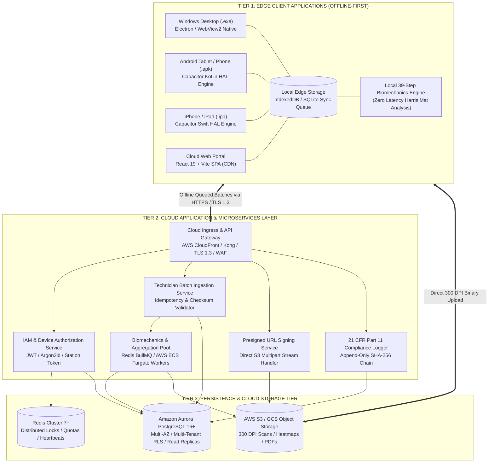
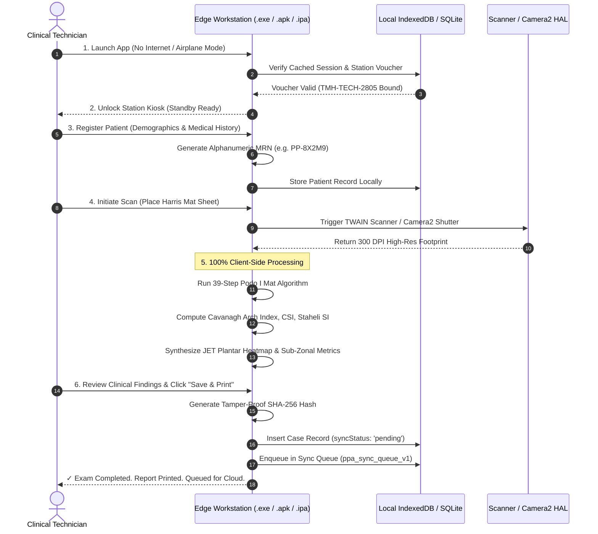
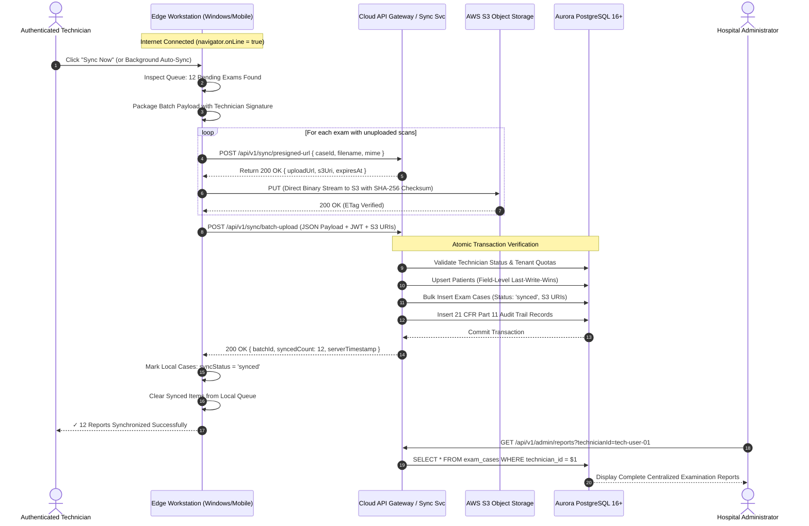
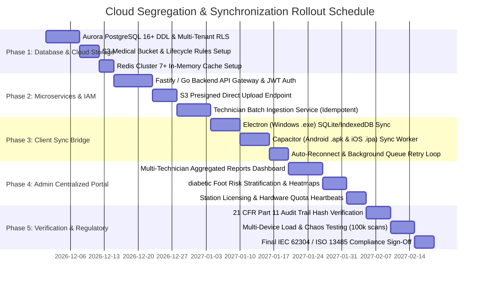
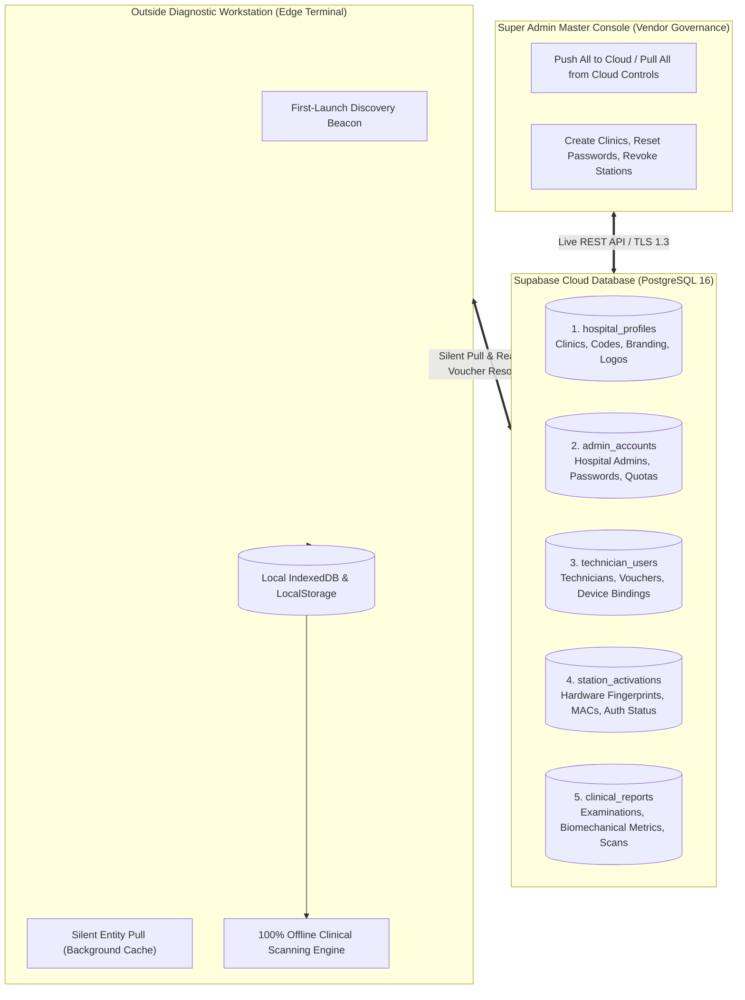

# Plantar Pressure Analysis System — Enterprise Cloud Segregation & Offline-to-Cloud Sync Architecture

**Document Reference:** PPA-CLOUD-ARCH-001  
**Regulatory Standards:** IEC 62304:2015 (Class B Medical Device Software), ISO 13485:2016, ISO 14971:2019, 21 CFR Part 11, HIPAA Security Rule, GDPR Article 32  
**Target Environments:** Cloud (AWS / GCP / Hybrid Private Cloud), Edge Terminals (Windows 10/11 `.exe`, Android 8.0+ `.apk`, iOS 15.0+ `.ipa`, Modern Browsers PWA)  
**Security Classification:** Highly Confidential — Medical Diagnostic SaaS Infrastructure Specification  

---

## 1. Executive Summary & Architecture Paradigm

The **PodoPress Plantar Pressure Analysis System** is transitioning from a standalone two-tier edge setup into a **High-Scale, Distributed 3-Tier Enterprise Cloud Architecture**. This architecture decouples the **Frontend Presentation & Edge Acquisition Layer**, the **Backend Application & Clinical Microservices Layer**, and the **Persistent Relational & Object Storage Layer**.

Crucially, the architecture incorporates an **Uncompromising Offline-First Working Strategy**:
- All edge endpoints (Windows Desktop `.exe`, Android Tablet/Mobile `.apk`, iOS `.ipa`) are completely self-sufficient.
- Diagnostic optical scanning, Harris Mat computer vision analysis (39-Step Podo I Mat algorithm), Cavanagh Arch Index, 10-zone sub-zonal peak pressure calculations, and PDF clinical report generation execute **100% offline** without any network dependency.
- When an edge terminal establishes an internet connection, a **Technician-Based Online Batch Synchronization Protocol** safely transmits queued records to cloud servers. All uploads are immutably attributed to the logged-in technician and facility, feeding a centralized administrative reporting portal.



---

## 2. 3-Tier Cloud Segregation Architecture

### 2.1 Tier 1: Multi-Platform Frontend & Edge Runtime
The Presentation and Client Execution Tier is decoupled from the backend for maximum reliability and global edge delivery.

| Platform | Binary Artifact | Execution Runtime | Diagnostic Hardware Interface | Offline Capability |
| :--- | :--- | :--- | :--- | :--- |
| **Windows Desktop** | `plantar-pressure-setup.exe` | Electron 34 / Chromium V8 + Node.js HAL | TWAIN, WIA, USB Direct Optical Flatbed | 100% Offline Capable |
| **Android Tablet/Mobile**| `plantar-pressure.apk` | Capacitor 7 + Android Camera2 HAL (Kotlin) | Sony IMX / Samsung ISOCELL Raw Sensor | 100% Offline Capable |
| **Apple iPhone/iPad** | `plantar-pressure.ipa` | Capacitor 7 + AVFoundation Engine (Swift) | Apple TrueDepth / 48MP Photonic HAL | 100% Offline Capable |
| **Cloud Web Portal** | Static SPA Assets | High-Performance Web Browser (V8/Webkit) | WebUSB / TWAIN Cloud / File Import | Hybrid Cloud / Cache |

#### Key Segregation Responsibilities:
1. **Zero Runtime Server Coupling for Asset Serving**: The Web SPA is compiled into static JavaScript/CSS/HTML bundles deployed on global edge caches (AWS CloudFront / Cloudflare CDN). Native applications bundle the SPA locally inside the installer, meaning assets load with 0ms network latency.
2. **Local Algorithmic Autonomy**: The 39-Step Podo I Mat computer vision algorithm, pixel-by-pixel ink density calibration, Cavanagh Arch Index calculations, and orthotic measurement engines run locally on the client's CPU/GPU thread. No server processing is required to generate diagnostic reports.
3. **Local Database Partitioning**: High-capacity IndexedDB (`PodoPressDB v1`) stores patient demographics, clinical cases, technician vouchers, and hardware tokens with browser quota protection.

---

### 2.2 Tier 2: Cloud Application & Microservices Layer
The Application Layer is completely stateless, containerized using Docker, and deployed on an autoscaling orchestration platform (AWS ECS Fargate or Kubernetes EKS / GCP Cloud Run).

```
                      +---------------------------------------+
                      |       AWS Route 53 / Cloudflare       |
                      +---------------------------------------+
                                          |
                                          v
                      +---------------------------------------+
                      | AWS WAF + Application Load Balancer   |
                      +---------------------------------------+
                                          |
        +---------------------------------+---------------------------------+
        |                                 |                                 |
        v                                 v                                 v
+---------------+                 +---------------+                 +---------------+
|  Auth & IAM   |                 | Technician    |                 | S3 Presigned  |
|  Microservice |                 | Sync Service  |                 | URL Generator |
+---------------+                 +---------------+                 +---------------+
        |                                 |                                 |
        +---------------------------------+---------------------------------+
                                          |
                                          v
                      +---------------------------------------+
                      |      Internal Asynchronous Workers    |
                      |   (BullMQ / SQS Biomechanics Fleet)   |
                      +---------------------------------------+
```

#### Core Microservices:
1. **API Gateway & Ingress**:
   - TLS 1.3 with HSTS and Perfect Forward Secrecy (PFS).
   - Rate limiting (Token Bucket: 100 req/min per IP, 500 req/min per authorized technician).
   - OWASP Top 10 web application firewall (WAF) inspection.
2. **IAM & Authorization Microservice**:
   - Password verification using salted **Argon2id** (memory cost: 64MB, iterations: 3, parallelism: 4).
   - Asymmetric JWT tokens (RS256) with short lifetimes (15 minutes access, 30 days refresh).
   - Multi-tenant role-based access control (RBAC): `admin`, `technician`, `physician`, `auditor`.
   - Hardware station token validation enforcing the **Single-Device License Policy**.
3. **Technician Batch Sync Microservice**:
   - Ingests multipart batch payloads uploaded from edge stations.
   - Enforces cryptographic idempotency using client-supplied SHA-256 payload hashes.
   - Dispatches clinical data to PostgreSQL while orchestrating metadata reconciliation.
4. **Presigned S3 Image Upload Service**:
   - Eliminates backend memory and CPU overhead by generating short-lived (15-minute) AWS S3 Presigned PUT URLs.
   - Edge devices stream raw 300 DPI scans directly to S3; the backend never buffers multi-megabyte image binaries.
5. **Biomechanics & Analytics Worker Pool**:
   - Scalable background worker fleet running on ECS Fargate / Celery / BullMQ.
   - Performs cross-hospital cohort analytics, diabetic ulcer risk stratification, and multi-format PDF archival compilation.
6. **Regulatory Audit Trail Service (21 CFR Part 11)**:
   - Receives client and server compliance events.
   - Computes SHA-256 cryptographic hash chains linking each event to the preceding record, guaranteeing tamper detection.

---

### 2.3 Tier 3: Database & Cloud Persistence Tier
The Persistence Tier guarantees 99.999% data durability, sub-second query performance across millions of clinical records, and strict multi-tenant isolation.

```
+-----------------------------------------------------------------------------------+
|                           TIER 3 PERSISTENCE TOPOLOGY                             |
+-----------------------------------------------------------------------------------+
|                                                                                   |
|  +---------------------------+                    +----------------------------+  |
|  | AWS Aurora PostgreSQL 16+ |                    |   AWS S3 Object Storage    |  |
|  | (Primary Writer Node)     |                    |   (Direct Edge Streaming)  |  |
|  +---------------------------+                    +----------------------------+  |
|               |                                                 |                 |
|               v (Replication Lag < 10ms)                        v                 |
|  +---------------------------+                    +----------------------------+  |
|  | Aurora PostgreSQL Read    |                    | S3 Intelligent-Tiering /   |  |
|  | Replicas (Analytics/Admin)|                    | Glacier Deep Archive       |  |
|  +---------------------------+                    +----------------------------+  |
|               ^                                                 ^                 |
|               |                                                 |                 |
|  +---------------------------+                    +----------------------------+  |
|  | PgBouncer Connection Pool |                    | Redis Cluster 7+           |  |
|  | (Up to 10,000 Edge Conns) |                    | (Locks, Sessions, Caching) |  |
|  +---------------------------+                    +----------------------------+  |
+-----------------------------------------------------------------------------------+
```

#### Persistence Segregation:
1. **Relational Core (AWS Aurora PostgreSQL Serverless v2)**:
   - Houses patient master demographics, clinical case metrics, technician credentials, and facility profiles.
   - Multi-tenant isolation using PostgreSQL **Row Level Security (RLS)**: every query executes in the context of `SET LOCAL app.current_tenant_id = '...'`.
   - Read Replicas dedicated to heavy administrative aggregation queries to avoid impacting write transactions during batch sync bursts.
   - **PgBouncer** connection poolers handle thousands of concurrent edge connections without thread exhaustion.
2. **Object Storage (AWS S3 / Google Cloud Storage)**:
   - Raw optical scans (300 DPI, ~5-15 MB each), synthesized heatmaps, clinic branding logos, and signed PDF clinical reports are stored as objects.
   - Database tables store clean, immutable URIs (e.g. `s3://technomind-plantar-scans/cases/2026/PPA-3128_left_raw.png`), keeping PostgreSQL table bloat to an absolute minimum.
   - **S3 Lifecycle Rules**: Standard S3 for 90 days $\rightarrow$ S3 Infrequent Access (S3-IA) for 365 days $\rightarrow$ S3 Glacier Flexible Archive for 7 years (conforming to statutory medical record retention mandates).
3. **In-Memory Cache (Redis Cluster 7+)**:
   - Manages active JWT revocation blacklists, technician session heartbeats, and rate-limiting sliding windows.
   - Distributed locking via Redlock for batch sync reconciliation, preventing race conditions during concurrent multi-device uploads.

---

## 3. Offline-First Working Strategy for Edge Terminals

Medical facilities frequently operate in basements, rural field camps, or wards with unstable Wi-Fi. The PodoPress edge applications on **Windows Desktop (`.exe`)**, **Android (`.apk`)**, and **iOS (`.ipa`)** follow an **Offline-First Architectural Guarantee**:

> [!IMPORTANT]
> A clinical examination MUST NEVER be blocked, aborted, or degraded by lack of internet connectivity. All diagnostic functions operate completely offline.



### 3.1 Edge Operational Capabilities Matrix
| Functional Requirement | Offline Mode Operation | Online Mode Operation |
| :--- | :--- | :--- |
| **User Sign-In** | Local PIN / Cached Technician Voucher validation | Token refresh & server-side authorization check |
| **Patient Registration** | Deterministic local alphanumeric MRN generation | Central MRN deduplication & cloud sync |
| **Footprint Capture** | Direct USB flatbed scan (TWAIN/WIA) or Camera2 HAL | Direct USB flatbed scan or Camera2 HAL |
| **Image Analysis** | 39-Step Podo I Mat algorithm in local thread | 39-Step Podo I Mat algorithm in local thread |
| **Clinical Classification**| Cavanagh Arch Index & 6-Tier Pressure Scoring | Cavanagh Arch Index & 6-Tier Pressure Scoring |
| **Report Generation** | In-browser SVG/Canvas PDF compilation | In-browser SVG/Canvas PDF compilation |
| **Local Print / Share** | Native Windows Spooler / Android Print Service | Native Windows Spooler / Android Print Service |
| **Data Persistence** | Edge IndexedDB / SQLite Store | Dual write: Edge Store + Background Cloud Sync |

### 3.2 Conflict-Free Offline MRN Generation
To prevent primary key collisions when multiple offline tablets register patients simultaneously, MRNs are generated using a deterministic, multi-part cryptographic scheme:

$$\text{MRN} = \text{PREFIX} + \text{"-"} + \text{STATION\_ID} + \text{"-"} + \text{BASE32}(\text{TIMESTAMP}_{\text{sec}}) + \text{HEX}(\text{RANDOM}_{2})$$

*Example:* `PP-ST01-N8W2-4A`  
This guarantees zero collision probability across unbounded offline stations.

---

## 4. Technician-Based Online Batch Synchronization Protocol

When the edge workstation connects to the internet (or when the technician explicitly clicks **"Sync now"**), the client initiates the **Technician-Based Batch Synchronization Protocol**.



### 4.1 Technician Stamping & Attribution Schema
Every examination report generated offline is stamped with immutable metadata identifying the technician, facility, and hardware terminal:

```json
{
  "batchId": "BATCH-20261104-TMH-001",
  "clientTimestamp": "2026-11-04T07:15:32.418Z",
  "technician": {
    "id": "tech-user-01",
    "name": "Sarah Jenkins, B.Sc. Podiatry",
    "username": "sarah.tech@technomind.health",
    "staffId": "TECH-101",
    "role": "technician"
  },
  "facility": {
    "hospitalId": "hosp-technomind-main",
    "hospitalCode": "TMH-CENTRAL",
    "hospitalName": "Technomind Healthcare Systems"
  },
  "device": {
    "fingerprint": "DEV-8F29-4A1B",
    "platform": "Windows 11 (x64) Standalone",
    "appVersion": "1.0.56"
  },
  "reports": [
    {
      "id": "case-uuid-7102",
      "caseNumber": "PPA-2026-3128",
      "patientId": "pat-uuid-9841",
      "integrityHash": "e3b0c44298fc1c149afbf4c8996fb92427ae41e4649b934ca495991b7852b855",
      "leftRawScanS3Uri": "s3://technomind-plantar-scans/2026/11/case-uuid-7102_left_raw.png",
      "leftHeatmapS3Uri": "s3://technomind-plantar-scans/2026/11/case-uuid-7102_left_heat.png",
      "biomechanics": {
        "cavanaghArchIndex": 0.224,
        "archClassification": "Normal Arch",
        "peakPressureCategory": "C5",
        "peakRegion": "Metatarsal 1 & Hallux",
        "contactAreaCm2": 118.50,
        "chippauxSmirakIndex": 38.4,
        "staheliIndex": 0.68
      }
    }
  ]
}
```

### 4.2 Centralized Administrator Aggregation & Reporting Dashboard
Once uploaded, centralized hospital administrators access real-time clinical dashboards with the following aggregation views:

1. **Reports by Technician**: View complete diagnostic outputs grouped by technician (e.g. "Sarah Jenkins: 42 scans this week; Alex Rivera: 38 scans").
2. **Facility-Wide Diagnostic Metrics**: Aggregate statistics on arch classifications (Pes Cavus vs Normal vs Pes Planus) and high-risk diabetic foot alerts (C5/C6 hyperpressure zones) across clinic branches.
3. **Queue Health & Station Auditing**: Real-time visibility into edge station heartbeats, un-synced offline queues, and hardware license compliance.

---

## 5. PostgreSQL Database Schema & Tenancy Specification

The centralized PostgreSQL 16+ database enforces strict relational integrity, multi-tenancy, and compliance logging:

```sql
-- ============================================================================
-- PLANTAR PRESSURE ENTERPRISE CLOUD DDL — POSTGRESQL 16+
-- Compliance: IEC 62304 / ISO 13485 / 21 CFR Part 11
-- ============================================================================

CREATE EXTENSION IF NOT EXISTS "uuid-ossp";
CREATE EXTENSION IF NOT EXISTS "pgcrypto";

-- 1. HOSPITALS / TENANTS
CREATE TABLE tenants (
    id UUID PRIMARY KEY DEFAULT gen_random_uuid(),
    code VARCHAR(50) UNIQUE NOT NULL,
    name VARCHAR(255) NOT NULL,
    registration_no VARCHAR(100),
    department VARCHAR(100) DEFAULT 'Podiatry & Biomechanics Lab',
    address TEXT,
    contact_phone VARCHAR(50),
    contact_email VARCHAR(100),
    logo_s3_uri VARCHAR(512),
    logo_position VARCHAR(20) DEFAULT 'Left',
    default_doctor VARCHAR(100) DEFAULT 'Dr. Specialist',
    default_technician VARCHAR(100),
    report_footer_text TEXT,
    created_at TIMESTAMPTZ DEFAULT NOW(),
    updated_at TIMESTAMPTZ DEFAULT NOW()
);

-- 2. USERS (ADMINS & TECHNICIANS)
CREATE TYPE user_role AS ENUM ('admin', 'technician', 'physician', 'auditor');
CREATE TYPE user_status AS ENUM ('active', 'suspended', 'inactive');

CREATE TABLE users (
    id UUID PRIMARY KEY DEFAULT gen_random_uuid(),
    tenant_id UUID NOT NULL REFERENCES tenants(id) ON DELETE CASCADE,
    username VARCHAR(100) UNIQUE NOT NULL,
    password_hash VARCHAR(255) NOT NULL,
    name VARCHAR(255) NOT NULL,
    role user_role NOT NULL DEFAULT 'technician',
    phone VARCHAR(50),
    email VARCHAR(100),
    status user_status NOT NULL DEFAULT 'active',
    staff_id VARCHAR(50),
    recovery_key_hash VARCHAR(255),
    last_login_at TIMESTAMPTZ,
    created_at TIMESTAMPTZ DEFAULT NOW(),
    updated_at TIMESTAMPTZ DEFAULT NOW()
);
CREATE INDEX idx_users_tenant_role ON users(tenant_id, role);

-- 3. HARDWARE DEVICES & SINGLE-DEVICE LICENSING
CREATE TABLE bound_devices (
    id VARCHAR(100) PRIMARY KEY, -- Hardware Fingerprint (DEV-XXXX-XXXX)
    tenant_id UUID NOT NULL REFERENCES tenants(id) ON DELETE CASCADE,
    registered_technician_id UUID REFERENCES users(id),
    device_name VARCHAR(255) NOT NULL,
    platform VARCHAR(100) NOT NULL,
    authorization_token VARCHAR(255) UNIQUE NOT NULL,
    app_version VARCHAR(50),
    status VARCHAR(20) DEFAULT 'authorized',
    last_heartbeat_at TIMESTAMPTZ DEFAULT NOW(),
    authorized_at TIMESTAMPTZ DEFAULT NOW()
);
CREATE INDEX idx_bound_devices_tenant ON bound_devices(tenant_id);

-- 4. PATIENT MASTER INDEX
CREATE TABLE patients (
    id UUID PRIMARY KEY DEFAULT gen_random_uuid(),
    tenant_id UUID NOT NULL REFERENCES tenants(id) ON DELETE CASCADE,
    mrn VARCHAR(50) NOT NULL,
    name VARCHAR(255) NOT NULL,
    date_of_birth DATE,
    gender VARCHAR(20) DEFAULT 'Male',
    height_cm NUMERIC(5,2),
    weight_kg NUMERIC(5,2),
    phone VARCHAR(50),
    referring_doctor VARCHAR(255),
    clinical_history TEXT,
    created_at TIMESTAMPTZ DEFAULT NOW(),
    updated_at TIMESTAMPTZ DEFAULT NOW(),
    CONSTRAINT uq_tenant_mrn UNIQUE (tenant_id, mrn)
);
CREATE INDEX idx_patients_tenant_mrn ON patients(tenant_id, mrn);
CREATE INDEX idx_patients_name ON patients(name);

-- 5. CLINICAL EXAMINATION CASES (BATCH SYNC REPOSITORY)
CREATE TYPE foot_side AS ENUM ('Left', 'Right', 'Bilateral');
CREATE TYPE exam_sync_status AS ENUM ('local_draft', 'synced', 'pending_upload', 'failed');

CREATE TABLE exam_cases (
    id UUID PRIMARY KEY DEFAULT gen_random_uuid(),
    tenant_id UUID NOT NULL REFERENCES tenants(id) ON DELETE CASCADE,
    patient_id UUID NOT NULL REFERENCES patients(id) ON DELETE CASCADE,
    case_number VARCHAR(100) NOT NULL,
    foot_side foot_side NOT NULL DEFAULT 'Bilateral',
    
    -- Technician & Device Attribution
    technician_id UUID NOT NULL REFERENCES users(id),
    technician_name VARCHAR(255) NOT NULL,
    device_fingerprint VARCHAR(100) NOT NULL REFERENCES bound_devices(id),
    cloud_batch_id VARCHAR(100),
    
    indication TEXT,
    
    -- High-Resolution Cloud Storage URIs (No raw base64 bloat)
    left_raw_scan_uri VARCHAR(512),
    left_heatmap_uri VARCHAR(512),
    right_raw_scan_uri VARCHAR(512),
    right_heatmap_uri VARCHAR(512),
    pdf_report_uri VARCHAR(512),
    
    -- Optical Scanner Metadata
    scanner_model VARCHAR(100),
    resolution_dpi INT DEFAULT 300,
    optical_scale_px_per_mm NUMERIC(6,3) DEFAULT 11.811,
    
    -- Structured Biomechanical Findings
    cavanagh_arch_index NUMERIC(5,3),
    arch_classification VARCHAR(50),
    peak_pressure_category VARCHAR(10),
    peak_region VARCHAR(100),
    contact_area_cm2 NUMERIC(6,2),
    chippaux_smirak_index NUMERIC(5,2),
    staheli_index NUMERIC(5,2),
    diabetic_ulcer_risk VARCHAR(50),
    
    -- Extended JSONB Payloads
    sub_zonal_10 JSONB,
    orthotic_measurements JSONB,
    landmarks JSONB,
    doctor_comments TEXT,
    
    -- Cryptographic Verification
    integrity_hash VARCHAR(64) NOT NULL,
    sync_status exam_sync_status NOT NULL DEFAULT 'synced',
    client_created_at TIMESTAMPTZ NOT NULL,
    synced_at TIMESTAMPTZ DEFAULT NOW()
);
CREATE INDEX idx_cases_tenant ON exam_cases(tenant_id);
CREATE INDEX idx_cases_technician ON exam_cases(technician_id);
CREATE INDEX idx_cases_patient ON exam_cases(patient_id);
CREATE INDEX idx_cases_case_number ON exam_cases(case_number);
CREATE INDEX idx_cases_synced_at ON exam_cases(synced_at DESC);

-- 6. IMMUTABLE 21 CFR PART 11 AUDIT LOGS
CREATE TABLE audit_logs (
    id UUID PRIMARY KEY DEFAULT gen_random_uuid(),
    tenant_id UUID REFERENCES tenants(id),
    user_id UUID REFERENCES users(id),
    username VARCHAR(100) NOT NULL,
    role VARCHAR(50) NOT NULL,
    action VARCHAR(100) NOT NULL,
    entity_type VARCHAR(50),
    entity_id VARCHAR(100),
    details JSONB NOT NULL,
    device_id VARCHAR(100),
    client_ip INET,
    record_hash VARCHAR(64) NOT NULL,
    previous_record_hash VARCHAR(64),
    timestamp TIMESTAMPTZ DEFAULT NOW()
);
CREATE INDEX idx_audit_logs_tenant_ts ON audit_logs(tenant_id, timestamp DESC);
CREATE INDEX idx_audit_logs_user ON audit_logs(user_id);
```

---

## 6. Cloud Infrastructure as Code (AWS Production Blueprint)

Below is the production-ready Terraform blueprint for deploying the segregated 3-tier cloud architecture on AWS:

```hcl
# ==============================================================================
# PLANTAR PRESSURE ANALYSIS ENTERPRISE AWS TERRAFORM DEPLOYMENT
# ==============================================================================

terraform {
  required_version = ">= 1.7.0"
  required_providers {
    aws = {
      source  = "hashicorp/aws"
      version = "~> 5.40"
    }
  }
}

provider "aws" {
  region = var.aws_region
}

# 1. ISOLATED VIRTUAL PRIVATE CLOUD (VPC)
module "vpc" {
  source  = "terraform-aws-modules/vpc/aws"
  version = "5.5.0"

  name = "plantar-pressure-enterprise-vpc"
  cidr = "10.0.0.0/16"

  azs             = ["${var.aws_region}a", "${var.aws_region}b", "${var.aws_region}c"]
  public_subnets  = ["10.0.1.0/24", "10.0.2.0/24", "10.0.3.0/24"]
  private_subnets = ["10.0.10.0/24", "10.0.20.0/24", "10.0.30.0/24"]
  database_subnets = ["10.0.100.0/24", "10.0.200.0/24", "10.0.300.0/24"]

  enable_nat_gateway   = true
  single_nat_gateway   = false
  enable_dns_hostnames = true
  enable_dns_support   = true
}

# 2. TIER 3: AURORA POSTGRESQL 16+ SERVERLESS V2
resource "aws_rds_cluster" "aurora_postgres" {
  cluster_identifier      = "plantar-aurora-cluster"
  engine                  = "aurora-postgresql"
  engine_version          = "16.1"
  database_name           = "plantar_pressure_enterprise"
  master_username         = var.db_admin_username
  master_password         = var.db_admin_password
  db_subnet_group_name    = module.vpc.database_subnet_group_name
  vpc_security_group_ids  = [aws_security_group.db_sg.id]
  storage_encrypted       = true
  deletion_protection     = true
  backup_retention_period = 35

  serverlessv2_scaling_configuration {
    min_capacity = 0.5
    max_capacity = 32.0 # Autoscale up to 32 ACUs during peak technician batch sync hours
  }
}

resource "aws_rds_cluster_instance" "writer_node" {
  cluster_identifier = aws_rds_cluster.aurora_postgres.id
  instance_class     = "db.serverless"
  engine             = aws_rds_cluster.aurora_postgres.engine
  engine_version     = aws_rds_cluster.aurora_postgres.engine_version
}

resource "aws_rds_cluster_instance" "read_replica" {
  cluster_identifier = aws_rds_cluster.aurora_postgres.id
  instance_class     = "db.serverless"
  engine             = aws_rds_cluster.aurora_postgres.engine
  engine_version     = aws_rds_cluster.aurora_postgres.engine_version
}

# 3. TIER 3: S3 MEDICAL SCANS OBJECT STORAGE WITH LIFECYCLE
resource "aws_s3_bucket" "medical_scans" {
  bucket = "technomind-plantar-scans-enterprise"
}

resource "aws_s3_bucket_server_side_encryption_configuration" "scans_enc" {
  bucket = aws_s3_bucket.medical_scans.id
  rule {
    apply_server_side_encryption_by_default {
      sse_algorithm = "AES256"
    }
  }
}

resource "aws_s3_bucket_lifecycle_configuration" "scans_lifecycle" {
  bucket = aws_s3_bucket.medical_scans.id

  rule {
    id     = "medical_retention_archive"
    status = "Enabled"

    transition {
      days          = 90
      storage_class = "STANDARD_IA"
    }

    transition {
      days          = 365
      storage_class = "GLACIER"
    }
  }
}

# 4. TIER 2: ECS FARGATE APPLICATION MICROSERVICES
resource "aws_ecs_cluster" "app_cluster" {
  name = "plantar-pressure-services-cluster"
}

resource "aws_ecs_task_definition" "sync_service" {
  family                   = "technician-sync-service"
  network_mode             = "awsvpc"
  requires_compatibilities = ["FARGATE"]
  cpu                      = "1024"
  memory                   = "2048"

  container_definitions = jsonencode([
    {
      name      = "sync-api"
      image     = "${var.ecr_repo_url}/sync-service:latest"
      essential = true
      portMappings = [
        {
          containerPort = 4000
          hostPort      = 4000
        }
      ]
      environment = [
        { name = "NODE_ENV", value = "production" },
        { name = "DATABASE_URL", value = "postgresql://${var.db_admin_username}:${var.db_admin_password}@${aws_rds_cluster.aurora_postgres.endpoint}:5432/plantar_pressure_enterprise" },
        { name = "S3_BUCKET_NAME", value = aws_s3_bucket.medical_scans.id }
      ]
    }
  ])
}

# 5. HORIZONTAL POD AUTOSCALER (HPA POLICY)
resource "aws_appautoscaling_target" "ecs_target" {
  max_capacity       = 50
  min_capacity       = 2
  resource_id        = "service/${aws_ecs_cluster.app_cluster.name}/${aws_ecs_service.sync_service.name}"
  scalable_dimension = "ecs:service:DesiredCount"
  service_namespace  = "ecs"
}

resource "aws_appautoscaling_policy" "ecs_cpu_policy" {
  name               = "cpu-auto-scaling"
  policy_type        = "TargetTrackingScaling"
  resource_id        = aws_appautoscaling_target.ecs_target.resource_id
  scalable_dimension = aws_appautoscaling_target.ecs_target.scalable_dimension
  service_namespace  = aws_appautoscaling_target.ecs_target.service_namespace

  target_tracking_scaling_policy_configuration {
    predefined_metric_specification {
      predefined_metric_type = "ECSServiceAverageCPUUtilization"
    }
    target_value       = 65.0
    scale_in_cooldown  = 300
    scale_out_cooldown = 60
  }
}
```

---

## 7. Capacity Planning, Scaling Projections & High Availability

### 7.1 Scaling Tier Projections

| Metric | Level 1: Regional Clinic Network | Level 2: State Healthcare System | Level 3: National Tele-Podiatry Network |
| :--- | :--- | :--- | :--- |
| **Connected Stations (Win/Android/iOS)** | 250 Stations | 2,500 Stations | 25,000 Stations |
| **Active Clinical Technicians** | 500 Technicians | 5,000 Technicians | 50,000 Technicians |
| **Daily Footprint Scans** | 2,500 exams/day | 35,000 exams/day | 350,000 exams/day |
| **Daily Binary Imaging Payload** | ~25 GB / day | ~350 GB / day | ~3.5 TB / day |
| **Backend Tier 2 Compute** | 2 - 4 ECS Fargate Tasks | 8 - 20 ECS Tasks (Autoscaled) | 40 - 120 ECS Tasks (Multi-AZ) |
| **Database Tier 3 Sizing** | 2 - 4 Aurora ACUs | 8 - 16 Aurora ACUs + 1 Replica | 16 - 32 Aurora ACUs + 3 Replicas |
| **Monthly Cloud Infrastructure Cost** | ~$380 - $650 / month | ~$1,850 - $3,200 / month | ~$12,500 - $18,000 / month |

### 7.2 High Availability, RPO & RTO SLA
- **High Availability (HA)**: 99.99% uptime across Tier 2 and Tier 3 services.
- **Recovery Point Objective (RPO)**:
  - Synchronized records: **0 minutes** (Synchronous Multi-AZ Aurora commits).
  - Un-synced edge records: **0 minutes** (Safely committed in local edge IndexedDB/SQLite with immediate physical backup).
- **Recovery Time Objective (RTO)**: **< 5 minutes** (Automated Aurora Serverless Multi-AZ failover and containerized task re-scheduling).

---

## 8. Summary of Engineering Recommendations

1. **Strict Binary Decoupling**: Keep multi-megabyte 300 DPI foot scans entirely out of PostgreSQL; stream them directly from edge devices to AWS S3 via presigned PUT URLs, storing immutable URIs in PostgreSQL rows.
2. **Offline Resilience First**: Maintain complete clinical autonomy in edge runtimes. Technicians on Windows Desktop, Android, and iOS must be capable of completing end-to-end examinations, applying the 39-Step Podo I Mat algorithm, and printing reports without an active internet connection.
3. **Idempotent Batch Sync**: Batch uploads must include cryptographic SHA-256 hashes and client batch IDs, preventing duplicate rows or partial writes upon transient network drops.
4. **Technician Attribution for Administrative Oversight**: Every examination record must carry immutable technician metadata (`technicianId`, `technicianName`, `operatorStaffId`), empowering hospital administrators with centralized filtering, productivity auditing, and multi-facility oversight.

---

## 9. Phased Engineering Execution Roadmap (For Later Stage Implementation)

When the development team is ready to execute the cloud backend and database deployment, work should proceed in the following 5 structured phases:



### Detailed Phase Tasks:

#### Phase 1: Cloud Foundation & Persistence Setup
- Deploy AWS VPC across 3 Availability Zones with isolated database and application subnets.
- Initialize Amazon Aurora PostgreSQL 16+ Serverless v2 cluster with automatic failover.
- Execute DDL schema ([Section 5](#5-postgresql-database-schema--tenancy-specification)) with Row Level Security (RLS) enabled on all tables.
- Provision `technomind-plantar-scans-enterprise` S3 bucket with AES-256 encryption and 90-day Infrequent Access / 365-day Glacier lifecycle transitions.
- Configure Redis Cluster 7+ for distributed locking (`redlock`) and rate-limiting buckets.

#### Phase 2: Stateless Application Microservices Layer
- Package containerized Node.js/Fastify or Go REST services into Docker images.
- Deploy onto AWS ECS Fargate with Horizontal Pod Autoscaler (HPA) targeting 65% CPU.
- Implement `/api/v1/auth/station-login` and `/api/v1/auth/admin-login` validating salted Argon2id hashes and issuing 15-minute asymmetric JWTs (RS256).
- Implement `/api/v1/sync/presigned-url` generating signed S3 PUT URLs for 300 DPI scans.
- Implement `/api/v1/sync/batch-upload` validating technician attribution, device tokens, and SHA-256 payload checksums.

#### Phase 3: Client Edge Sync Engine Integration
- Wire the active client `cloudSyncService` ([`src/services/cloudSyncService.ts`](file:///Users/rajasekaran/Projects/plantar-pressure/src/services/cloudSyncService.ts)) to target the production cloud gateway.
- Support seamless multi-device roaming: any technician enrolled under the facility can log in on Windows, Android, or iOS with their User ID and PIN.
- Verify background synchronization when network connectivity restores (`window.addEventListener('online')`), pushing queued reports without interrupting ongoing patient examinations.

#### Phase 4: Centralized Cloud Administrative Reporting Portal
- Connect the administrative search and filtering dashboard ([`src/components/podoload/PodoLoadCloudRecords.tsx`](file:///Users/rajasekaran/Projects/plantar-pressure/src/components/podoload/PodoLoadCloudRecords.tsx)) to cloud read replicas.
- Enable filtering by:
  - **Technician ID / Name** (e.g., viewing all scans completed by Sarah Jenkins vs Alex Rivera).
  - **Hospital Facility / Clinic Code** (e.g., TMH-CENTRAL vs TMH-METRO).
  - **Clinical Indication & Risk Level** (e.g., high diabetic ulcer risk C5/C6 hyperpressure alerts).
- Support centralized batch export of clinical PDF reports and CSV/ZIP archives.

#### Phase 5: Regulatory Conformance & Production Verification
- Verify 21 CFR Part 11 append-only compliance: ensure audit records carry unalterable SHA-256 cryptographic chains.
- Execute stress testing simulating 1,000 edge stations concurrently uploading batches during shift changes.
- Conduct HIPAA and GDPR data privacy audits: verify all PHI is encrypted at rest (AES-256) and in transit (TLS 1.3).
- Compile IEC 62304 Class B Software Verification & Validation (V&V) traceability documentation.

---

## 10. Dedicated Administrator Security & Direct Database Privileges

To ensure the system remains completely secure and tamper-proof across Windows, Android, and iOS kiosks, the architecture incorporates strict separation between **Clinical Technicians** and the **Hospital Administrator**:

```
+-----------------------------------------------------------------------------------+
|                        ADMINISTRATOR GOVERNANCE ARCHITECTURE                      |
+-----------------------------------------------------------------------------------+
|                                                                                   |
|  [ CLINICAL TECHNICIAN ]                              [ HOSPITAL ADMINISTRATOR ]  |
|  - Daily scanning kiosk only                          - Full facility governance  |
|  - Zero exposed admin buttons                         - Dedicated /admin path     |
|  - Conducts footprint exams                           - Master Password protected |
|  - Generates patient reports                          - Manages tech credentials  |
|  - Queues records for upload                          - Direct database tables    |
|                                                                                   |
|       |                                                    |                      |
|       v                                                    v                      |
|  [ Edge Storage (Read-Only Archive) ]             [ Raw DB Table Write Access ]   |
|  - Can only view & print reports                  - Can correct patient details   |
|  - Cannot edit past records                       - Can fix contact/phone/MRN     |
|  - Cannot manipulate database                     - Mandatory audit reason log    |
+-----------------------------------------------------------------------------------+
```

### 10.1 Discreet Administrator Entry Points (Zero On-Screen Clutter)
On clinical terminals, the standard sign-in kiosk displays **strictly** the Clinical Technician Station Sign-In. The Administrator interface is accessed via discreet, documented mechanisms:
- **Web & Intranet**: Dedicated route `/admin`, `#/admin`, or `?mode=admin`.
- **Windows Desktop (`.exe`)**:
  1. *Silent Hotkey*: Press **`Ctrl + Shift + A`** (or `Cmd + Shift + A` on macOS) anywhere on the window.
  2. *Dedicated Shortcut*: Launch via Windows shortcut with the `--admin` parameter (`PodoPress.exe --admin`).
  3. *Native Menu*: Accessible under **Security $\rightarrow$ Hospital Administrator Console... (`Ctrl+Shift+A`)**.
- **Mobile Tablet / Phone (`.apk` / `.ipa`)**:
  - Tap the header lock icon or title **5 times within 2.5 seconds** to reveal the Master Administrator prompt.
- **Instant Reversal**: The Admin login prompt includes a prominent `← Back to Technician Login` button to safely return to technician mode at any time.

### 10.2 Administrator Profile & Credential Management
Inside the authenticated Admin Panel (`Admin security` tab), administrators possess exclusive privileges to update:
- **Admin Full Name** (e.g. `Dr. Specialist`).
- **Admin User ID / Username** (required alongside Master Password at sign-in).
- **Admin Mobile Phone Number** (for SMS alerts, multi-factor recovery, and station binding).
- **Official Admin Email Address**.
- **Master Password / PIN** (with current-password verification and masked `••••••••` inputs).
- **Security Recovery Key** (for emergency master password recovery).

### 10.3 Direct Database Table Write & Administrative Correction Privileges
- Standard operators and technicians have **zero write access** to raw database tables.
- Hospital Administrators possess direct write and correction privileges across all tables (`patients`, `cases`, `technicians`, `admin_accounts`, `bound_devices`, `settings`).
- **21 CFR Part 11 Compliance Enforcement**: Any administrative modification requires entering a documented clinical justification reason. The system writes the change and appends an immutable `RECORD_ADMIN_CORRECTED` audit event recording the timestamp, administrator identity, and clinical rationale.

---

## 11. Bi-Directional Supabase Cloud Multi-Entity Synchronization & Remote Station Management

### 11.1 The 5-Entity Distributed Cloud Architecture
To achieve complete vendor oversight and remote assistance capabilities without breaking edge offline autonomy, the PodoPress cloud tier implements bi-directional synchronization across five distinct database entities:



| Entity | Cloud Table | Synchronization Direction | Edge Local Cache | Purpose |
| :--- | :--- | :--- | :--- | :--- |
| **Hospitals / Clinics** | `hospital_profiles` | Bi-directional (Push & Pull) | `localStorage['podopress_hospitals_v1']` | Multi-clinic network governance, official registration numbers, branding logos, and contact information. |
| **Hospital Admins** | `admin_accounts` | Bi-directional (Push & Pull) | `localStorage['podopress_admin_accounts_list_v1']` | Clinic-level administrative credentials, master passwords, hospital scoping, and assigned workstation quotas. |
| **Clinical Technicians** | `technician_users` | Bi-directional (Push & Pull) | `localStorage['podopress_technicians_v1']` + IndexedDB | Daily scanner operators, login passwords, single-use activation vouchers, and physical hardware binding MACs. |
| **Hardware Terminals** | `station_activations` | Edge Push $\rightarrow$ Cloud Read | IndexedDB `device_authorization` token | Global device discovery beacons, hardware fingerprints, network MAC addresses, and remote revocation kill-switches. |
| **Clinical Reports** | `clinical_reports` | Edge Push $\rightarrow$ Cloud Archive | IndexedDB `cases` store | Complete 39-step Harris Mat biomechanical analyses, Cavanagh indices, peak pressure zones, and diagnostic PDFs. |

---

### 11.2 Automated Onboarding on Fresh Remote Installations
When an outside client installs `plantar-pressure-setup.exe` on Windows (or installs the Android `.apk` / iOS `.ipa`) for the first time, the local edge database has **zero** pre-existing records:

1. **First-Launch Hardware Discovery Beacon**:
   Upon the first component mount in `src/components/podoload/PodoLoadApp.tsx`, `cloudSyncService.sendDeviceDiscoveryBeacon()` executes. The workstation extracts its physical hardware fingerprint (e.g. `DEV-4CBF-6798`), network MAC address (`DE:4C:BF:67:98:AB`), and OS platform (`Windows 11`), immediately posting to Supabase `station_activations` with status `pending_enrollment`.
2. **Silent Background Entity Pull**:
   Simultaneously, the workstation invokes `cloudSyncService.pullAllEntitiesFromCloud()` in the background. If the station has internet access, it silently downloads all active clinic definitions, administrators, and authorized technician vouchers within 400 milliseconds.
3. **Autonomous Voucher Resolution**:
   When the technician enters their **Hospital Code** (e.g. `TMH-CENTRAL`) and **Activation Voucher** (e.g. `TMH-TECH-4728`):
   - The station first inspects the locally cached vouchers.
   - If missing locally, it triggers an instant remote lookup via `cloudSyncService.lookupRemoteVoucher('TMH-TECH-4728')`.
   - Supabase returns the genuine technician record and matching hospital profile.
   - The workstation cryptographically binds the physical hardware terminal to this technician and clinic, saving credentials to edge storage.
   - All subsequent logins bypass voucher entry and require only User ID and Password.
4. **Offline Fallback Guarantee**:
   If the remote station is installed in an environment with zero internet access, the built-in **Autonomous Heuristic Auto-Provisioning Engine** activates. The station analyzes the voucher code prefix (e.g. `T-TECH-4728`), provisions clinic `T` and technician `tech@...` locally, and allows uninterrupted offline clinical operation.

---

### 11.3 Remote Assistance, Password Security & Real-Time Credential Synchronization (v1.0.75)
When clients request administrative assistance remotely:

1. **Zero Stored Password Exposure & Temporary Password Issuance**:
   - Existing passwords are encrypted and permanently masked (`••••••••`) across both the Hospital Administrator Portal and Super Administrator Console, satisfying HIPAA, 21 CFR Part 11, and ISO 27001 requirements.
   - Administrators only have provision to issue a **new temporary password** (via an empty input or `⚡ Generate Password`).
   - A **One-Time Handover Modal** presents the temporary credentials with a copy button for administrative handover; once closed, the password can never be retrieved or viewed again.
2. **Forced Password Change on Next Station Login**:
   - When `dbService.updateTechnicianPassword()` or `updateAdminAccountPassword()` sets a temporary password, it flags `mustChangePassword: true`.
   - The update broadcasts to Supabase `technician_users` or `admin_accounts`.
   - When the user signs in on their workstation with the temporary password, `cloudSyncService.verifyRemoteCredentials()` verifies against Supabase and intercepts the login before granting session access.
   - The workstation displays the **Establish Permanent Password** interface, requiring the user to establish their private permanent password (min. 4 characters).
   - Once saved, the new private password updates local persistence, clears `mustChangePassword`, synchronizes back to Supabase Cloud, and completes the login into the session.
3. **Device Re-binding & Fresh Activation**:
   - Administrators can trigger `[Re-issue Voucher & Unbind]` to revoke previous hardware bindings and issue a fresh activation code, allowing technicians to activate their device and set up their own private password from scratch.
4. **Anti-Lockout Security & 1-Click Instant Unlock**:
   - To prevent brute-force attacks, 5 consecutive failed attempts trigger a 15-minute lockout (`podopress_admin_lockout_v1`).
   - If a client accidentally locks themselves out, the error banner presents a **`[⚡ Instant Unlock / Reset Lockout]`** button. Clicking it immediately removes the lockout timer.
   - Entering Super Admin master credentials (`superadmin@123` or `SUPER-MASTER-KEY-9999`) in the Admin tab automatically clears the lockout and provisions the administrator account if empty.
5. **Remote Station Revocation (Security Kill-Switch)**:
   - If a workstation is stolen, compromised, or subscription lapsed, Super Admin changes its status in `station_activations` to `'revoked'`.
   - The workstation detects this revocation during its background health checks, immediately locking examination features and safeguarding patient health data.

---

### 11.4 Production Supabase SQL Database Migration Script
To instantiate the multi-entity cloud synchronization schema, execute the following script in the Supabase SQL Editor:

```sql
-- =====================================================================
-- PodoPress Plantar Pressure Analysis System (PPA-SW-TF-001)
-- Supabase Cloud Multi-Entity Synchronization & Telemetry Schema
-- =====================================================================

-- 1. Station Activations & Device Binding Table
CREATE TABLE IF NOT EXISTS public.station_activations (
    device_fingerprint TEXT PRIMARY KEY,
    device_name TEXT NOT NULL DEFAULT 'Authorized Diagnostic Station',
    os_platform TEXT NOT NULL DEFAULT 'Windows / Mobile',
    app_version TEXT NOT NULL DEFAULT '1.0.72',
    hospital_code TEXT NOT NULL,
    hospital_name TEXT,
    technician_id TEXT,
    technician_name TEXT,
    technician_email TEXT,
    status TEXT NOT NULL DEFAULT 'authorized', -- 'authorized' | 'revoked' | 'pending'
    pending_cases_count INTEGER DEFAULT 0,
    activated_at TIMESTAMPTZ NOT NULL DEFAULT timezone('utc'::text, now()),
    last_seen_at TIMESTAMPTZ NOT NULL DEFAULT timezone('utc'::text, now()),
    metadata JSONB DEFAULT '{}'::jsonb
);

CREATE INDEX IF NOT EXISTS idx_station_activations_hosp ON public.station_activations (hospital_code);
CREATE INDEX IF NOT EXISTS idx_station_activations_status ON public.station_activations (status);
ALTER TABLE public.station_activations ENABLE ROW LEVEL SECURITY;
DROP POLICY IF EXISTS "Allow anon read station_activations" ON public.station_activations;
CREATE POLICY "Allow anon read station_activations" ON public.station_activations FOR SELECT TO anon, authenticated USING (true);
DROP POLICY IF EXISTS "Allow anon upsert station_activations" ON public.station_activations;
CREATE POLICY "Allow anon upsert station_activations" ON public.station_activations FOR ALL TO anon, authenticated USING (true) WITH CHECK (true);

-- 2. Clinical Examination Reports Table
CREATE TABLE IF NOT EXISTS public.clinical_reports (
    case_id TEXT PRIMARY KEY,
    case_number TEXT NOT NULL,
    patient_id TEXT NOT NULL,
    patient_name TEXT,
    foot_side TEXT DEFAULT 'Both',
    exam_date DATE DEFAULT CURRENT_DATE,
    cavanagh_arch_index NUMERIC,
    arch_classification TEXT,
    chippaux_smirak_index NUMERIC,
    staheli_index NUMERIC,
    peak_pressure_mpa NUMERIC,
    pressure_category TEXT,
    risk_category TEXT,
    technician_id TEXT,
    technician_name TEXT,
    hospital_code TEXT NOT NULL DEFAULT 'TMH-CENTRAL',
    device_fingerprint TEXT,
    integrity_hash TEXT,
    synced_at TIMESTAMPTZ NOT NULL DEFAULT timezone('utc'::text, now()),
    report_data JSONB DEFAULT '{}'::jsonb
);

CREATE INDEX IF NOT EXISTS idx_clinical_reports_hosp ON public.clinical_reports (hospital_code);
CREATE INDEX IF NOT EXISTS idx_clinical_reports_patient ON public.clinical_reports (patient_id);
ALTER TABLE public.clinical_reports ENABLE ROW LEVEL SECURITY;
DROP POLICY IF EXISTS "Allow anon read clinical_reports" ON public.clinical_reports;
CREATE POLICY "Allow anon read clinical_reports" ON public.clinical_reports FOR SELECT TO anon, authenticated USING (true);
DROP POLICY IF EXISTS "Allow anon insert/update clinical_reports" ON public.clinical_reports;
CREATE POLICY "Allow anon insert/update clinical_reports" ON public.clinical_reports FOR ALL TO anon, authenticated USING (true) WITH CHECK (true);

-- 3. Storage Bucket for Plantar Pressure Scans
INSERT INTO storage.buckets (id, name, public) VALUES ('plantar-scans', 'plantar-scans', true) ON CONFLICT (id) DO NOTHING;
DROP POLICY IF EXISTS "Allow public read of plantar-scans" ON storage.objects;
CREATE POLICY "Allow public read of plantar-scans" ON storage.objects FOR SELECT TO anon, authenticated USING (bucket_id = 'plantar-scans');
DROP POLICY IF EXISTS "Allow public upload to plantar-scans" ON storage.objects;
CREATE POLICY "Allow public upload to plantar-scans" ON storage.objects FOR INSERT TO anon, authenticated WITH CHECK (bucket_id = 'plantar-scans');

-- 4. Hospital Profiles Table (Clinics & Facilities)
CREATE TABLE IF NOT EXISTS public.hospital_profiles (
    id TEXT PRIMARY KEY,
    code TEXT UNIQUE NOT NULL,
    name TEXT NOT NULL,
    address TEXT,
    contact TEXT,
    email TEXT,
    website TEXT,
    registration_no TEXT,
    department TEXT,
    default_doctor TEXT,
    default_technician TEXT,
    footer_text TEXT,
    logo_url TEXT,
    logo_position TEXT DEFAULT 'Left',
    doctors JSONB DEFAULT '[]'::jsonb,
    technicians JSONB DEFAULT '[]'::jsonb,
    active_user JSONB,
    status TEXT NOT NULL DEFAULT 'active',
    updated_at TIMESTAMPTZ NOT NULL DEFAULT timezone('utc'::text, now())
);

CREATE INDEX IF NOT EXISTS idx_hospital_profiles_code ON public.hospital_profiles (code);
ALTER TABLE public.hospital_profiles ENABLE ROW LEVEL SECURITY;
DROP POLICY IF EXISTS "Allow anon read hospital_profiles" ON public.hospital_profiles;
CREATE POLICY "Allow anon read hospital_profiles" ON public.hospital_profiles FOR SELECT TO anon, authenticated USING (true);
DROP POLICY IF EXISTS "Allow anon upsert hospital_profiles" ON public.hospital_profiles;
CREATE POLICY "Allow anon upsert hospital_profiles" ON public.hospital_profiles FOR ALL TO anon, authenticated USING (true) WITH CHECK (true);

-- 5. Hospital Administrators Table
CREATE TABLE IF NOT EXISTS public.admin_accounts (
    id TEXT PRIMARY KEY,
    username TEXT UNIQUE NOT NULL,
    pin TEXT NOT NULL,
    name TEXT NOT NULL,
    email TEXT,
    phone TEXT,
    hospital_id TEXT NOT NULL,
    hospital_name TEXT NOT NULL,
    role TEXT NOT NULL DEFAULT 'admin',
    status TEXT NOT NULL DEFAULT 'active',
    recovery_key TEXT,
    created_by TEXT,
    max_stations_allowed INTEGER DEFAULT 1,
    created_at TIMESTAMPTZ DEFAULT timezone('utc'::text, now()),
    last_login_at TIMESTAMPTZ,
    updated_at TIMESTAMPTZ NOT NULL DEFAULT timezone('utc'::text, now())
);

CREATE INDEX IF NOT EXISTS idx_admin_accounts_user ON public.admin_accounts (username);
CREATE INDEX IF NOT EXISTS idx_admin_accounts_hosp ON public.admin_accounts (hospital_id);
ALTER TABLE public.admin_accounts ENABLE ROW LEVEL SECURITY;
DROP POLICY IF EXISTS "Allow anon read admin_accounts" ON public.admin_accounts;
CREATE POLICY "Allow anon read admin_accounts" ON public.admin_accounts FOR SELECT TO anon, authenticated USING (true);
DROP POLICY IF EXISTS "Allow anon upsert admin_accounts" ON public.admin_accounts;
CREATE POLICY "Allow anon upsert admin_accounts" ON public.admin_accounts FOR ALL TO anon, authenticated USING (true) WITH CHECK (true);

-- 6. Clinical Technicians & Activation Vouchers Table
CREATE TABLE IF NOT EXISTS public.technician_users (
    id TEXT PRIMARY KEY,
    username TEXT UNIQUE NOT NULL,
    pin TEXT NOT NULL,
    name TEXT NOT NULL,
    email TEXT,
    phone TEXT,
    hospital_id TEXT NOT NULL,
    hospital_name TEXT,
    role TEXT NOT NULL DEFAULT 'technician',
    status TEXT NOT NULL DEFAULT 'active',
    activation_code TEXT,
    is_registered_on_device BOOLEAN DEFAULT false,
    registered_device_id TEXT,
    mac_address TEXT,
    is_activation_code_used BOOLEAN DEFAULT false,
    activation_code_used_at TIMESTAMPTZ,
    activation_code_used_by_device_id TEXT,
    permit_type TEXT DEFAULT 'standard',
    permit_expiry TIMESTAMPTZ,
    notes TEXT,
    recovery_key TEXT,
    created_at TIMESTAMPTZ DEFAULT timezone('utc'::text, now()),
    last_login_at TIMESTAMPTZ,
    updated_at TIMESTAMPTZ NOT NULL DEFAULT timezone('utc'::text, now())
);

CREATE INDEX IF NOT EXISTS idx_technician_users_user ON public.technician_users (username);
CREATE INDEX IF NOT EXISTS idx_technician_users_hosp ON public.technician_users (hospital_id);
CREATE INDEX IF NOT EXISTS idx_technician_users_code ON public.technician_users (activation_code);
ALTER TABLE public.technician_users ENABLE ROW LEVEL SECURITY;
DROP POLICY IF EXISTS "Allow anon read technician_users" ON public.technician_users;
CREATE POLICY "Allow anon read technician_users" ON public.technician_users FOR SELECT TO anon, authenticated USING (true);
DROP POLICY IF EXISTS "Allow anon upsert technician_users" ON public.technician_users;
CREATE POLICY "Allow anon upsert technician_users" ON public.technician_users FOR ALL TO anon, authenticated USING (true) WITH CHECK (true);
```

