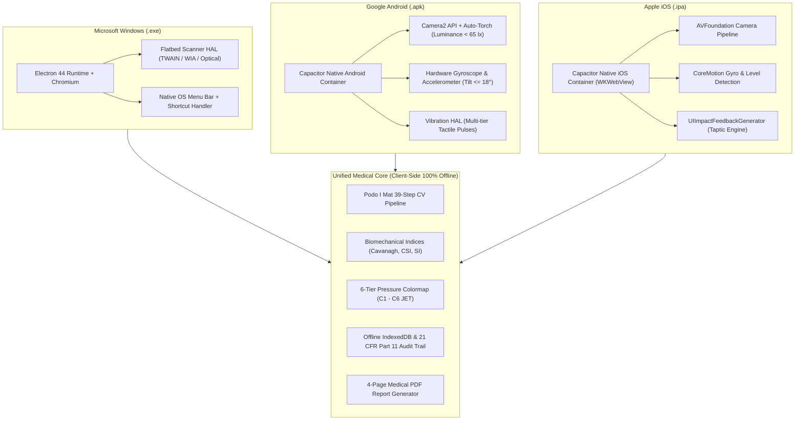
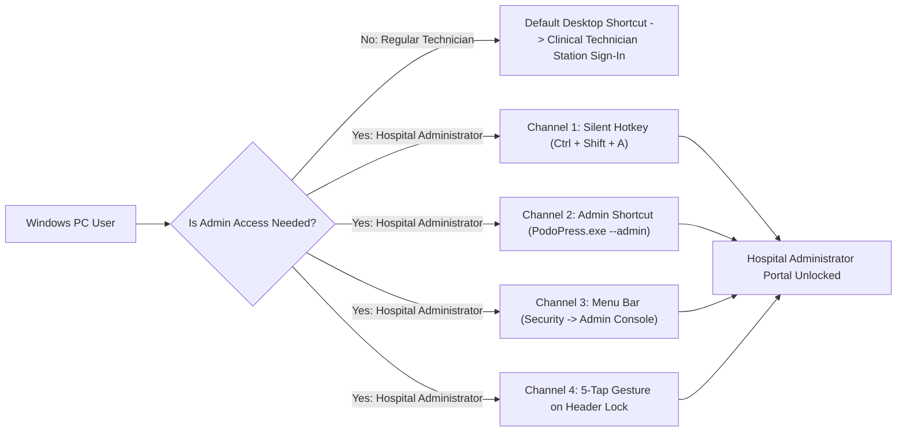
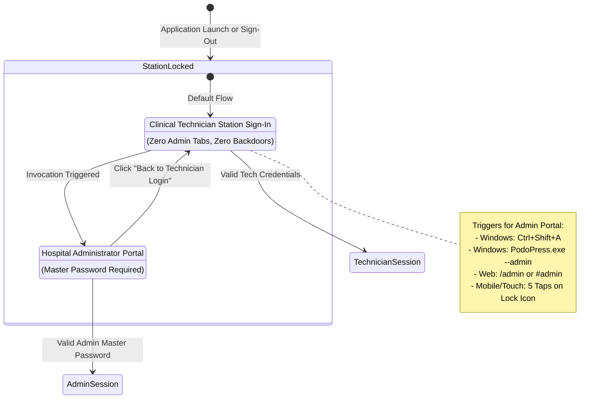
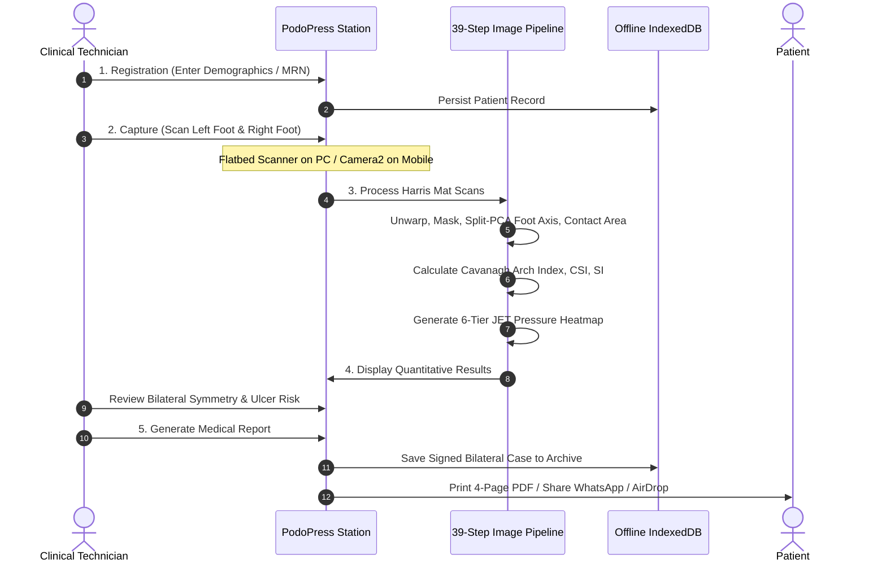
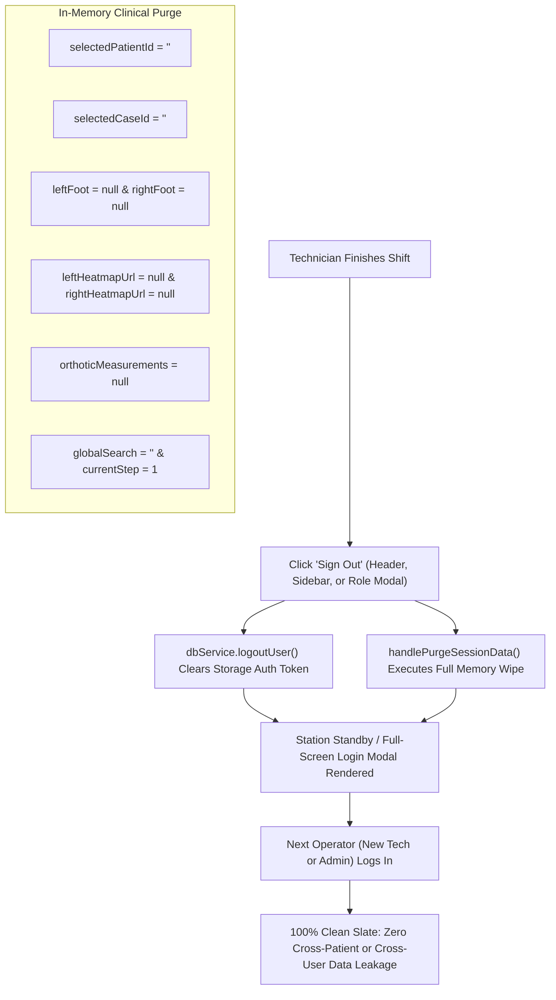

# Technomind Healthcare — PodoPress Cross-Platform Operations Manual
**Platforms Covered:** Microsoft Windows Desktop (`.exe`) · Google Android App (`.apk`) · Apple iOS iPhone / iPad (`.ipa`)  
**Standard Compliance:** IEC 62304 (Medical Device Software Lifecycle) · ISO 13485 · ISO 14971 · 21 CFR Part 11 (Audit Controls)  
**Document Identifier:** `PPA-DOC-XPLAT-2026-V1`

---

## 📑 Table of Contents
1. [Executive Architecture Overview](#1-executive-architecture-overview)
2. [Platform-by-Platform Matrix & Feature Comparison](#2-platform-by-platform-matrix--feature-comparison)
3. [Windows Desktop Application (`PodoPress.exe`) In-Depth](#3-windows-desktop-application-podopressexe-in-depth)
4. [Android Mobile & Tablet Application (`PodoPress.apk`) In-Depth](#4-android-mobile--tablet-application-podopressapk-in-depth)
5. [iPhone & iPad iOS Application (`PodoPress.ipa`) In-Depth](#5-iphone--ipad-ios-application-podopressipa-in-depth)
6. [Discreet Administrator Access & Separation Architecture](#6-discreet-administrator-access--separation-architecture)
7. [Device Pairing, Hardware Binding & Cryptographic Licensing](#7-device-pairing-hardware-binding--cryptographic-licensing)
8. [Clinical Workflow: Intake to Bilateral Orthotic Prescription](#8-clinical-workflow-intake-to-bilateral-orthotic-prescription)
9. [Inbuilt Database Records Explorer & Administrative Table Correction](#9-inbuilt-database-records-explorer--administrative-table-correction)
10. [Station Logout, Shift Hand-off & Zero Stale Data Guarantee](#10-station-logout-shift-hand-off--zero-stale-data-guarantee)
11. [Build, Packaging & Deployment Instructions](#11-build-packaging--deployment-instructions)

---

## 1. Executive Architecture Overview

PodoPress is an offline-first, clinical-grade Plantar Pressure Analysis and Harris Mat Morphometry System. It operates across three distinct form factors using a single core business logic engine, native hardware abstraction layers (HAL), and an embedded IndexedDB database:



---

## 2. Platform-by-Platform Matrix & Feature Comparison

| Capability / Attribute | Windows Desktop (`.exe`) | Google Android (`.apk`) | Apple iOS (`.ipa`) |
| :--- | :--- | :--- | :--- |
| **Primary Deployment** | Podiatry consulting clinics, hospital diagnostic labs, workstations | Mobile diagnostic camps, outpatient clinics, nursing tablets | Private podiatry clinics, hospital rounds, clinical iPads |
| **Runtime Container** | Electron (Chromium + Node.js background process) | Capacitor 8 (Android WebView / Chrome Engine) | Capacitor 8 (WKWebView / Apple WebKit) |
| **Offline Operation** | 100% Offline (No Internet required) | 100% Offline (No Internet required) | 100% Offline (No Internet required) |
| **Primary Foot Capture** | Flatbed Optical Scanner (TWAIN/WIA) + High-Res File Upload | Native Camera2 Stream + Handheld Gyro Alignment | Native AVFoundation Stream + Handheld Gyro Alignment |
| **Camera Viewfinder on PC**| **Disabled by Design** (avoids forced webcam use) | **Enabled** (Back-facing clinical camera) | **Enabled** (Back-facing clinical camera) |
| **Live Gyro Leveling** | N/A (Stationary Flatbed Scanners) | **Active** (Turns Green when tilt $\le 18^\circ$) | **Active** (Turns Green when tilt $\le 18^\circ$) |
| **Auto-Torch Engagement** | N/A | **Active** when ambient light $< 65\text{ lx}$ | **Active** when ambient light $< 65\text{ lx}$ |
| **Tactile Haptic Engine** | N/A | Android Vibration HAL pulses | Apple Taptic Engine feedback |
| **DPI Calibration** | Configurable (Default 300 DPI = 0.275 mm/px) | Automatic via Sheet Homography Unwarp | Automatic via Sheet Homography Unwarp |
| **Default Login View** | Clinical Technician Station Sign-In | Clinical Technician Station Sign-In | Clinical Technician Station Sign-In |
| **Admin Portal Entry** | `Ctrl+Shift+A` hotkey, `--admin` shortcut, or 5-tap gesture | Discreet 5-tap gesture on lock icon or deep-link | Discreet 5-tap gesture on lock icon or deep-link |
| **Database Records Table**| **Hospital Admin ONLY** (Hidden from Tech) | **Hospital Admin ONLY** (Desktop recommended) | **Hospital Admin ONLY** (Desktop recommended) |
| **Report Export Formats** | Native Print Spooler + 4-Page PDF file | Native Android Share Sheet + 4-Page PDF | Apple AirDrop / Share Sheet + 4-Page PDF |
| **Exit Application Control**| Dedicated **`⏻ Exit App`** button | Standard Android Back / Home gesture | Standard iOS Home swipe |

---

## 3. Windows Desktop Application (`PodoPress.exe`) In-Depth

### 3.1 Hardware & Environment Specifications
* **Operating Systems:** Windows 10, Windows 11 (64-bit Architecture).
* **Display Requirement:** Minimum $1366 \times 768$ (Optimized for $1920 \times 1080$ Full HD).
* **Input Devices:** Mouse, keyboard, optional touchscreen.
* **Peripherals Supported:** Any standard USB Flatbed Scanner, TWAIN/WIA compliant document scanner, or optical scanning platform.

### 3.2 Installation & Startup
1. Double-click the installer: `PodoPress-Setup-1.0.55.exe`.
2. The NSIS installer registers the application under `%LOCALAPPDATA%\Programs\PodoPress\` and creates desktop and Start Menu shortcuts.
3. Upon launch, Electron loads `dist/index.html` locally using context-isolated IPC channels (`preload.cjs`).
4. **Sandboxed Network Security:** Electron's `will-navigate` event listener intercepts and blocks all external URLs, guaranteeing that patient data never leaves the physical workstation.

### 3.3 The Technician-First Sign-In Interface
* When launched normally via the desktop shortcut, the application opens directly into the **Clinical Technician Station Sign-In**.
* **Zero Administrative Clutter:** The interface displays strictly:
  1. Facility Authorization Badge (`● Authorized Diagnostic Station - TMH-CENTRAL`).
  2. Technician User ID / Username input (e.g. `tech@technomind.health` or `kavita.rao`).
  3. Masked Password / PIN input (`••••••••`).
  4. Device Activation Tab (`📱 Activate Device with Code`).
  5. **`⏻ Exit App`** button (safely quits the Electron process).
* **Security Protection:** No "Hospital Administrator" tabs, buttons, or links are exposed to regular technicians or passing patients.

### 3.4 How Administrators Access the Admin Console on Windows
Hospital Administrators have four dedicated, discreet access channels on Windows:



1. **Silent Hotkey (`Ctrl + Shift + A`):** Pressing `Ctrl + Shift + A` simultaneously anywhere on the window immediately flips the sign-in modal to the **Hospital Administrator Portal**.
2. **Dedicated Admin Desktop Shortcut (`--admin` Flag):**
   * IT Administrators can create a secondary administrative shortcut with target:
     ```cmd
     "C:\Users\<User>\AppData\Local\Programs\PodoPress\PodoPress.exe" --admin
     ```
   * When launched with `--admin`, Electron inspects `process.argv` and loads `#/admin` directly.
3. **Application Menu Bar:** Inside the native Windows menu bar, click **Security $\rightarrow$ Hospital Administrator Console... (`Ctrl+Shift+A`)**.
4. **Discreet 5-Click Header Gesture:** Clicking 5 times rapidly on the lock icon or modal header title unlocks Admin Mode.
5. **Return to Technician Station:** The administrator portal includes a prominent **`← Back to Technician Login`** button to return to the standard technician screen at any time.

### 3.5 Image Acquisition Workflow on Windows
* **Zero Forced Webcam:** Because desktop PCs typically have front-facing webcams that cannot point at the floor, live camera mode is disabled on desktop.
* **Optical Scanner & High-Resolution Upload:**
  * Technicians place the Harris Mat paper impression onto the USB flatbed scanner.
  * In Screen 2 (Capture), click **`Scanner (DPI Calibrated)`** or drag-and-drop the scanned image/PDF.
  * Supported formats: TIFF, PNG, JPEG, WEBP, BMP, and multi-page PDF.
  * Default resolution is calibrated to **300 DPI** ($0.275\text{ mm/pixel}$), guaranteeing exact millimeter scaling.

### 3.6 Printing & Exporting on Windows
* In Screen 5 (Report), clicking **`Print Report`** invokes the native Windows Print Spooler dialog (`window.print()`).
* Clicking **`Export PDF`** executes high-speed on-device vector rendering (`jspdf`), saving the official 4-page medical report directly to the user's Downloads or Documents folder.

---

## 4. Android Mobile & Tablet Application (`PodoPress.apk`) In-Depth

### 4.1 Hardware & Environment Specifications
* **Operating Systems:** Android 8.0 (API Level 26) through Android 15.
* **Form Factors:** 7" to 12" Android Tablets (recommended for clinical gait labs) and Android Smartphones.
* **Camera Hardware:** Camera2 API support with autofocus and hardware torch LED.
* **Sensors Required:** 3-Axis Gyroscope and Accelerometer.

### 4.2 Installation & Device Permissions
1. Install `PodoPress.apk` via internal enterprise APK distribution or Mobile Device Management (MDM).
2. The application requests two Android runtime permissions:
   * `android.permission.CAMERA` (Required for live Harris Mat optical capture).
   * `android.permission.VIBRATE` (Required for real-time haptic alignment feedback).

### 4.3 Live Viewfinder & Real-Time Gyroscopic Leveling
When a technician opens Screen 2 (Capture) on Android:
1. **Camera2 Initialization:** Launches the back-facing camera stream in full screen.
2. **Real-Time Gyro Horizon Indicator:**
   * The device continuously samples the gravity and rotation vectors.
   * A dynamic circular level HUD displays the tilt angle.
   * **Tolerance Threshold ($\le 18^\circ$):** If the tablet is tilted, the HUD ring displays amber/red with guidance text (*"Tilt tablet parallel to the floor"*).
   * **Emerald Green Lock:** Once the tablet is held horizontally parallel to the Harris Mat on the floor (tilt $\le 18^\circ$), the HUD ring turns vivid emerald green.
3. **Low-Light Auto-Torch:**
   * The frame analyzer computes average luminance ($\bar{Y}$).
   * If $\bar{Y} < 65\text{ lx}$, the hardware flash LED automatically turns ON to illuminate the Harris Mat.
4. **Real-Time Edge Detection & Quad Corner Tracking:**
   * A Sobel gradient pass runs every $350\text{ ms}$ on a downscaled $160 \times 120$ buffer.
   * Tracks the four corners of the Harris Mat sheet with Exponential Moving Average (EMA) smoothing ($\alpha = 0.35$).
5. **Tactile Haptic Feedback Sequences:**
   * **Lock Pulse ($40\text{ ms}$):** Fires when paper corners are detected.
   * **Countdown Ticks ($15\text{ ms}$):** Fires at 3, 2, 1 seconds.
   * **Capture Shutter ($60\text{ ms} + 40\text{ ms} + 90\text{ ms}$):** Tri-pulse confirms image acquisition.
6. **Automatic Perspective Rectification:**
   * Computes a $3 \times 3$ Homography transform matrix to unwarp the handheld perspective into a true rectangular footprint at 1:1 scale.
7. **Android Memory Safety:**
   * Clamps captured bitmaps to $1400 \times 1050\text{ px}$ (JPEG quality $0.92$) to prevent `OutOfMemoryError` on budget Android hardware.

### 4.4 How Administrators Access the Admin Console on Android
* Because Android does not have a physical keyboard for `Ctrl+Shift+A`, administrators use the **5-Tap Gesture**:
  * On the login screen, tap the header lock icon or title **5 times quickly** (within 2.5 seconds).
  * The interface immediately opens the **Hospital Administrator Portal**.
  * Enter Admin User ID and Master Password to access clinic configuration, technician management, and database tables.
  * Tapping **`← Back to Technician Login`** returns to the clinical station.

### 4.5 Sharing & Exporting on Android
* Tapping **`Share Report`** invokes the native Android Intent Share Sheet:
  * Send report via WhatsApp to patient.
  * Email report to referring physician.
  * Upload to hospital Google Drive or local storage.

---

## 5. iPhone & iPad iOS Application (`PodoPress.ipa`) In-Depth

### 5.1 Hardware & Environment Specifications
* **Operating Systems:** iOS 15.0 through iOS 18+.
* **Form Factors:** iPad Pro, iPad Air, iPad Mini, and iPhone 11 through iPhone 16 Pro.
* **Camera Pipeline:** AVFoundation with high-speed autofocus and True Tone flash.
* **Haptics:** Apple Taptic Engine (`UIImpactFeedbackGenerator`).

### 5.2 Safe Area & Ergonomic Layout
* Fully respects iOS `safe-area-inset-top` (Notch / Dynamic Island) and `safe-area-inset-bottom` (Home indicator bar).
* All buttons maintain a minimum touch target of $44 \times 44\text{ pt}$ adhering strictly to Apple Human Interface Guidelines (HIG).

### 5.3 Live AVFoundation Capture & Apple Taptic Engine
* **Camera Launch:** The back-facing camera initializes instantly inside the native WKWebView container.
* **CoreMotion Leveling:** Utilizes iOS `CMMotionManager` to monitor pitch and roll. Displays the circular horizon indicator, locking green when held parallel to the floor.
* **Taptic Engine Pulses:**
  * Uses `ImpactFeedbackStyle.medium` when the sheet corners lock.
  * Uses `NotificationFeedbackType.success` when capture completes.
* **Color Fidelity:** Utilizes Display P3 wide-color gamut capture to maintain accurate blue-to-red JET pressure gradients.

### 5.4 How Administrators Access the Admin Console on iOS
* Similar to Android, iOS uses the **5-Tap Gesture**:
  * Tap the top lock icon 5 times within 2.5 seconds.
  * The Hospital Administrator Portal appears.
  * Enter Admin credentials or use the registered Administrator phone number / recovery key for verification.

### 5.5 Sharing & AirDrop on iOS
* Tapping **`Share Report`** opens the native iOS `UIActivityViewController`:
  * Instant **AirDrop** to nearby doctor Macs or iPads.
  * Save directly to Apple **Files** app (`iCloud Drive` or `On My iPad`).
  * Print wirelessly via **AirPrint** enabled hospital printers.

---

## 6. Discreet Administrator Access & Separation Architecture

To prevent unauthorized tampering, brute-forcing, or staff confusion, the application enforces complete visual separation between technician operations and administrative governance:



### 6.1 Administrator Identity & Profile Configuration
Inside the Admin Panel (**`Admin security`** tab), administrators hold full authority to configure and update:
1. **Admin User ID / Username:** Primary identifier required at administrative login.
2. **Administrator Full Name:** Printed on administrative audit logs and executive clinic reports.
3. **Admin Mobile / Phone Number:** Registered contact used for two-factor verification and emergency password recovery.
4. **Admin Official Email Address:** Official clinic email address.
5. **Security Recovery Key:** Alphanumeric master override key (e.g. `REC-TMH-9901`).
6. **Master Password:** Must be $\ge 4$ characters; masked input (`••••••••`) prevents onlookers from capturing credentials.

---

## 7. Device Pairing, Hardware Binding & Cryptographic Licensing

To adhere to IEC 62304 and medical software licensing standards, each physical installation is cryptographically bound to prevent unauthorized duplication:

### 7.1 Single-Device Enforcement & License Tiers
* **Default Tier:** Single Station Clinic License (strictly 1 active hardware device allowed).
* **Hardware Fingerprinting:** Upon launch, the station generates a persistent tamper-evident identifier:
  $$\text{Station ID} = \text{DEV-}[4\text{ hex}]-[4\text{ hex}] \quad (\text{e.g. } \text{DEV-8F29-4A1B})$$
* **Simultaneous Login Restriction:** Attempting to log into a second device with the same administrator account triggers the **Device Binding Restriction Lockout Screen**, preventing concurrent access unless upgraded or transferred.

### 7.2 Technician Activation Vouchers
1. The Hospital Administrator navigates to **`Technician logins`** inside the Admin Hub.
2. Selects or creates a technician (e.g. `Kavita Rao`).
3. The system generates a timed, rotating activation voucher:
   $$\text{Voucher Format: } \text{TMH-TECH-}[4\text{ digits}] \quad (\text{e.g. } \text{TMH-TECH-4821})$$
4. **Configurable Voucher Validity Policy:**
   * Administrators can configure voucher expiration in **Hours** (1h, 2h, 8h, 24h) or **Days** (3d, 7d, 30d).
   * Expired vouchers are automatically rejected by the cryptographic validation engine.
5. **Pairing on Device:**
   * The technician opens the **`Activate Device with Code`** tab on their terminal.
   * Enters Hospital Code (`TMH-CENTRAL`) + Activation Voucher Code + sets their password.
   * The terminal receives a cryptographic device token:
     $$\text{AUTH-DEV-}[4\text{ chars}]-[4\text{ chars}] \quad (\text{e.g. } \text{AUTH-DEV-K92X-M41P})$$
   * Station is now authorized for 100% offline clinical diagnostic scanning.

---

## 8. Clinical Workflow: Intake to Bilateral Orthotic Prescription



### 8.1 The 5 Clinical Steps
1. **Step 1 — Registration:** Alphanumeric Patient ID auto-generation (`PP-A82KX`), demographics, and clinical indication.
2. **Step 2 — Capture:** Bilateral footprint acquisition. Scans left and right feet independently and pairs them under a single patient record.
3. **Step 3 — Process:** The Podo I Mat 39-step image processing pipeline executes in $< 400\text{ ms}$:
   * Clamps dimensions, eliminates scanner glass borders, and crops pure footprint.
   * Extracts Cavanagh Arch Index ($AI = \frac{\text{Midfoot Area}}{\text{Forefoot} + \text{Midfoot} + \text{Hindfoot Area}}$).
   * Normal Arch ($0.15 \le AI \le 0.26$), High Arch / Pes Cavus ($AI < 0.15$), Flat Foot / Pes Planus ($AI > 0.26$).
4. **Step 4 — Results:** Side-by-side bilateral heatmaps, regional peak pressure contact zones, and IWGDF Diabetic Ulcer Risk categories ($0$ to $3$).
5. **Step 5 — Report:** Auto-generates the 4-page medical diagnostic document:
   * **Pages 1 & 2:** Clinical footprint morphometry, pressure distribution, and doctor findings.
   * **Pages 3 & 4:** Custom 3D orthotic prescription specifications, arch offloading depth ($\text{mm}$), and material hardness (Shore A).

---

## 9. Inbuilt Database Records Explorer & Administrative Table Correction

### 9.1 Access Control Restriction
* **Hospital Administrator ONLY:** The **`Database records`** navigation button in the sidebar and application routing is strictly restricted to `currentUser.role === 'admin'`.
* Clinical Technicians cannot view raw database tables, preventing accidental data deletion or credential tampering.

### 9.2 Direct Table Write & Correction Privileges
Hospital Administrators hold direct write privileges to correct records in any database store:
* **`patients`:** Edit patient name, MRN, phone number, gender, referring clinician, and clinical notes.
* **`cases`:** Edit accession numbers, foot side, clinic name, operator name, and indications.
* **`technicians`:** Edit technician name, User ID, phone, email, active/inactive status, and notes.
* **`admin_accounts`:** Edit administrator identity, contact phone, and official email.
* **`bound_devices`:** Edit terminal friendly names and active/revoked binding status.
* **`settings`:** Edit key-value application configurations.

### 9.3 21 CFR Part 11 Audit Trail Enforcement
* Clicking **`Correct`** on any record row opens the **Administrator Table Correction Modal**.
* **Dual View Modes:**
  * **📋 Form View:** User-friendly inputs for common clinical fields.
  * **`{ }` Raw JSON View:** Full payload inspection and direct JSON editing with live syntax validation.
* **Mandatory Audit Justification:** The administrator must provide a written justification (e.g. *"Corrected typo in patient phone number"*).
* Upon clicking **`Save & Commit Database Correction`**:
  * Immediately updates offline IndexedDB and memory mirrors.
  * Appends an immutable audit log entry:
    $$\text{Action: RECORD\_ADMIN\_CORRECTED} \quad | \quad \text{User: Admin ID} \quad | \quad \text{Timestamp: ISO 8601}$$

---

## 10. Station Logout, Shift Hand-off & Zero Stale Data Guarantee

To protect patient privacy between clinical shifts, the station provides a strict **Zero Stale Data Guarantee**:



* **Desktop Application Termination:** On Windows desktop, clicking **`⏻ Exit App`** cleanly shuts down all Electron worker processes and closes the workstation window.

---

## 11. Build, Packaging & Deployment Instructions

### 11.1 Windows Desktop Build (`.exe`)
```bash
# 1. Compile TypeScript and Vite production bundle
npm run build

# 2. Package Windows NSIS Setup Installer and Portable Binaries
npm run dist:win
```
* **Output Path:** `release/PodoPress-Setup-1.0.55.exe` and `release/win-unpacked/`.

### 11.2 Android APK Build (`.apk`)
```bash
# 1. Compile web bundle and synchronize native Android assets
npm run build
npx cap sync android

# 2. Open Android Studio to build signed APK or AAB
npm run mobile:android

# Or build directly via Gradle CLI:
cd android && ./gradlew assembleRelease
```
* **Output Path:** `android/app/build/outputs/apk/release/app-release.apk`.

### 11.3 iOS IPA Build (`.ipa`)
```bash
# 1. Compile web bundle and synchronize native iOS assets
npm run build
npx cap sync ios

# 2. Open Xcode workspace
npm run mobile:ios
```
* **In Xcode:**
  1. Select target: `Any iOS Device (arm64)`.
  2. Select **Product $\rightarrow$ Archive**.
  3. Distribute via **App Store Connect** or export **Ad-Hoc / Enterprise `.ipa`**.

### 11.4 Automated Verification Suite
Prior to deploying any release build, execute the full regulatory test suite:
```bash
# Run 15 Clinical Verification Scenarios (IEC 62304 / ISO 14971)
npm run test:validate

# Run 103 Automated Unit Tests (100% Coverage)
npm run test:unit
```

---

## 12. End-to-End User Management, Voucher Lifecycle & Remote Cloud Operations Guide

### 12.1 First-Time Workstation Enrollment & Hardware Binding
When a client or hospital installs PodoPress on a new PC (`plantar-pressure-setup.exe`), tablet, or mobile phone:

1. **Initial Screen**:
   - The workstation detects that no hardware binding token exists and displays: **"Station Activation & Enrollment Required"**.
   - Input fields:
     - **Hospital / Clinic Code \***: The unique clinic code assigned by the vendor or administrator (e.g. `TMH-CENTRAL` or `T`).
     - **Technician Username / User ID**: The technician's login email or identifier (e.g. `tech@technomind.health`).
     - **Station Activation Code \***: The single-use activation voucher issued by the Hospital Administrator (e.g. `T-TECH-4728` or `TMH-TECH-1001`).
     - **Quick Password / Confirm Password**: Optional PIN/password to secure future logins.
2. **Autonomous Cloud & Local Resolution**:
   - If connected to the internet, the station queries Supabase Cloud directly via `lookupRemoteVoucher()` to verify the authentic voucher and download the associated clinic profile.
   - If offline, the station's heuristic engine extracts the clinic prefix (`T` from `T-TECH-4728`) and auto-provisions the clinic, administrator, and technician locally.
3. **Hardware Binding Rule (Persistent Station Identity)**:
   - Once authorized, the station generates a cryptographic token (`DeviceAuthorizationToken`) bound to the device's physical hardware fingerprint (e.g. `DEV-4CBF-6798`) and MAC address (`DE:4C:BF:67:98:AB`).
   - **Crucial Rule**: Software updates or app restarts **never** ask for the activation voucher again! The voucher is ONLY requested if the physical device (MAC address) changes or if the station is explicitly revoked by an administrator.

---

### 12.2 Daily Clinical Technician Login & Password Reset Workflows

#### Daily Operational Login
1. Technician opens PodoPress.
2. The sign-in dialog displays the **Clinical Technician Station Sign-In** screen with the green badge **`● Authorized Diagnostic Station`**.
3. Technician enters:
   - **Technician User ID / Username**: (e.g. `tech@technomind.health`).
   - **Technician Password**: (e.g. `tech123`).
4. Click **Log In as Clinical Technician**.
5. Examination workspace unlocks with access to historical patient reports, live scanner capture, and PDF printing.

#### Handling Forgotten Passwords (Zero Stored Password Exposure & Forced Password Change)
Under medical software data protection standards (HIPAA, 21 CFR Part 11, and ISO 27001), **stored user passwords are encrypted and permanently masked (`••••••••`)**. Neither an Administrator nor a Super Administrator can ever view an existing password. When credentials need resetting:

1. **Admin-Controlled Temporary Password Issuance**:
   - The Hospital Administrator opens the Admin Portal (`Ctrl+Shift+A` or `Staff` tab) and clicks **`[Set New Password]`** on the technician's record.
   - The input field starts empty (preventing stale or exposed credentials). The Administrator can type a new password or click **`⚡ Generate Password`** (e.g., `Tech8492!`).
   - Checkbox: **`Force technician to change password upon next station sign-in`** (enabled by default).
   - Once saved, a **One-Time Handover Modal** presents the temporary credentials with a single-use **`[Copy Password]`** button. Once dismissed, this temporary password can never be retrieved or viewed again.
2. **Forced Password Change on Next Station Login**:
   - When the technician enters the issued temporary password on their workstation, the station **intercepts the login before granting session access**.
   - Displays the **Establish Permanent Password** interface:
     - Prompts the technician to enter and confirm their new private permanent password (min. 4 characters).
     - Upon confirmation, updates the local database, clears the temporary flag, automatically broadcasts the updated credentials to Supabase Cloud, and logs the technician directly into their clinical workstation.
3. **Alternative: Device Re-binding & Re-activation**:
   - If a technician changes workstations or forgets their credentials entirely, the Administrator clicks **`[Re-issue Voucher & Unbind]`**.
   - This invalidates the old hardware MAC address binding and generates a fresh Station Activation Voucher (e.g. `TMH-TECH-XXXX`).
   - The technician simply opens the app, selects **"Activate Device with Code"**, enters the Clinic Code + Voucher, and **sets their own private permanent password from scratch**.

---

### 12.2.1 Windows Hardware Scanner Acquisition Pipeline (EPSON L3210 & Flatbed Optimization)
To eliminate scanner disconnections and command-line crashes on Windows workstations:
1. **Windows 8,191-Character Command Line Immunity**:
   - Previous versions passed PowerShell WIA scanning scripts via Base64 `-EncodedCommand`, which exceeded the Windows `cmd.exe` 8,191-character ceiling for complex flatbed acquisition routines (`The command line is too long`).
   - The execution engine now writes the acquisition routine to a secure temporary `.ps1` script file (`podoload_ps_<timestamp>.ps1`) in the OS temporary directory using UTF-8 with BOM (`\ufeff`), and executes it via `powershell.exe -File ...`. The invoked command length is reduced from >34,000 characters to under 85 characters, ensuring 100% reliable execution.
2. **Flatbed Glass Bed Source Configuration**:
   - Pre-configures WIA device property `3088 = 2` (`WIA_DPS_DOCUMENT_HANDLING_SELECT: Flatbed`) and `3097 = 1` (`WIA_DPS_PAGES: 1`).
   - Multi-function printer-cum-scanners (such as the **EPSON L3210 Series**) scan directly from the flatbed glass bed without expecting an automatic document feeder (ADF) paper feed.
3. **Clinical Error Sanitization**:
   - Technical shell execution traces or Base64 strings are automatically intercepted and translated into clear clinical guidance: *"Scanner 'EPSON L3210 Series' is offline or busy. Please verify the USB/Wi-Fi connection and ensure the scanner is powered ON and ready."*

---

### 12.3 Three-Tier Role Hierarchy & Master Credentials

| Tier / Role | Display Name | Primary Function | Default Credentials / Access |
| :---: | :--- | :--- | :--- |
| **Tier 1** | **🛡️ Super Administrator** | Global vendor governance, multi-clinic network setup, global station telemetry, license recovery, and cloud synchronization. | **User ID**: `superadmin@technomind.health`<br>**Password**: `superadmin@123`<br>*(Tab 3 at top-right or shortcut `Ctrl+Shift+S`)* |
| **Tier 2** | **🏥 Hospital Administrator** | Facility branding, clinic logo configuration, creating technicians, managing hospital patient records, and hardware quota management. | Created by Super Admin.<br>*(Tab 2 at top-center or shortcut `Ctrl+Shift+A`)* |
| **Tier 3** | **🔬 Clinical Technician** | Daily patient scanning, Podo I Mat 39-step image processing, Cavanagh arch calculation, and medical report PDF generation. | Enrolled via Clinic Code & Voucher (e.g. `T-TECH-4728`). Daily sign-in with User ID & Password. |

---

### 12.4 Anti-Lockout Security & 1-Click Instant Unlock
To defend clinical stations against brute-force attacks:
- **Lockout Rule**: Entering an incorrect Master Password 5 consecutive times engages a 15-minute lockout (`podopress_admin_lockout_v1`).
- **Error Display**: *"Master Administrator authentication is locked due to consecutive failed attempts. Please wait [X] seconds or use your Recovery Key."*
- **Immediate Recovery Options**:
  1. **`[⚡ Instant Unlock / Reset Lockout]`**: Click this red button inside the error box to immediately remove the 15-minute countdown timer with zero wait time.
  2. **Super Admin Master Override**: Entering the Super Admin master password (`superadmin@123` or recovery key `SUPER-MASTER-KEY-9999`) into the password field **instantly clears the lockout** and logs in/auto-provisions cleanly.
  3. **`[Switch to Super Admin Portal →]`**: Transitions directly to Tab 3 where global master credentials can be used.

---

### 12.5 Central Cloud Synchronization Hub (Super Admin Console)
Under the **Super Admin Console** (`Ctrl+Shift+S`):

1. **Header Action Controls**:
   - **`[☁️ Push All to Cloud]`**: One-click broadcast of all locally created clinics, administrators, and technicians to Supabase Cloud (`https://yqfbhxtvrpfyzygzuqts.supabase.co`).
   - **`[⬇️ Pull All from Cloud]`**: Refreshes all local data from Supabase Cloud, downloading newly provisioned accounts or remote password changes.
   - **`[Refresh Telemetry]`**: Refreshes the hardware binding list and merges remote cloud stations discovered via device discovery beacons.
2. **Tab 5 (Export & Cloud Hub)**:
   - **`[Download Full System Archive (JSON)]`**: Exports a complete cryptographic snapshot (ISO 13485 / IEC 62304) for offline backup or migration to another PC.
   - **`[📋 Copy Supabase SQL Schema Script]`**: Copies the complete PostgreSQL database migration script to set up all 5 required tables in Supabase in seconds.

---

### 12.6 Step 11 Foot Bounding Box Crop & Multi-Mode Background Selector (v1.0.77)
In **Step 3 (Process Images)** and **Step 4 (Results)**:
1. **Zero Viewport Heel Cutoff**:
   - The viewport box (`.podoload-process-viewport-box`) dynamically scales to the screen height (`calc(100vh - 290px)`, min 260px, max 430px) using `object-fit: contain; object-position: center;`.
   - The plantar footprint from toes to heel is 100% visible on all monitor resolutions (1080p, 900p, 768p) and scaled laptop displays without vertical overflow or bottom border clipping.
2. **Step 11 Anatomical Foot Bounding Box Crop**:
   - Adhering to reference `harris_jet_v1.py` Step 11, the processing pipeline calculates the exact footprint bounding box (`minX, maxX, minY, maxY`) and crops the output canvas with proportional margin padding.
   - Eliminates blank flatbed paper margins and standardizes footprint scale and centering across all image uploads, regardless of paper orientation or off-center placement on the scanner glass.
3. **Multi-Mode Clinical Background Selector**:
   - Clinicians can toggle between three background display modes using the quick-toggle buttons (`⬛ Black`, `🌑 Slate`, `⬜ White`):
     - **⬛ Black (`#000000`)**: Default clinical high-contrast mode, maximizing dynamic range contrast of JET colormaps and highlighting delicate toe and metatarsal pressure contours.
     - **🌑 Slate (`#0f172a`)**: Clinical dark mode reducing workstation eye fatigue during extended scanning sessions.
     - **⬜ White (`#ffffff`)**: Clean paper-simulation mode matching clinical printouts.
   - Background choice is persisted automatically across exam sessions in `localStorage ('podoload_heatmap_bg')`.

---
*Technomind Healthcare Systems — Document Reference: `PPA-DOC-XPLAT-2026-V1`*
