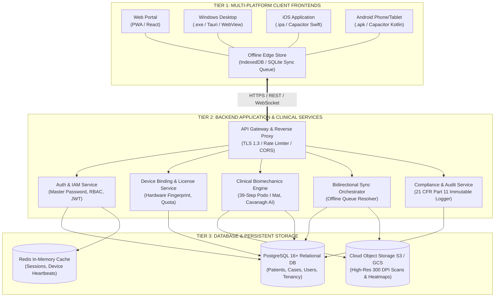
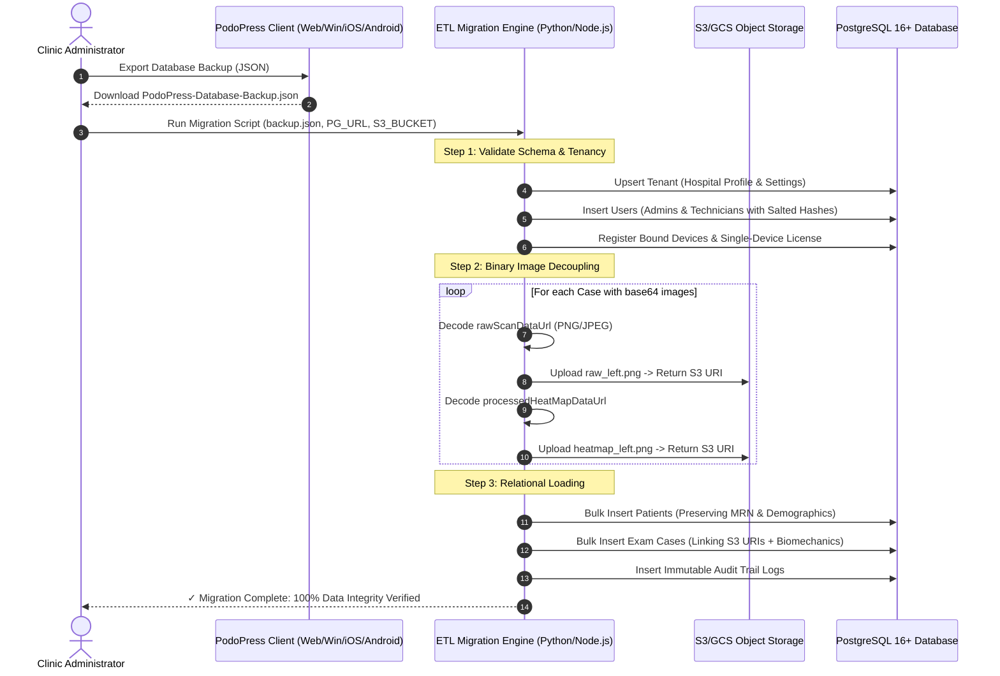
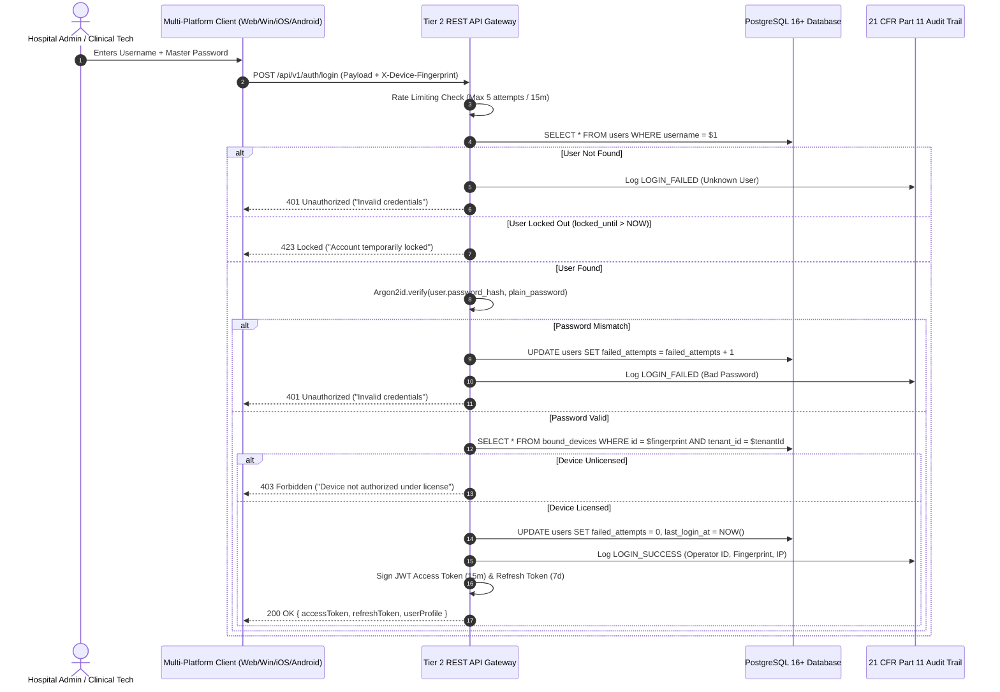
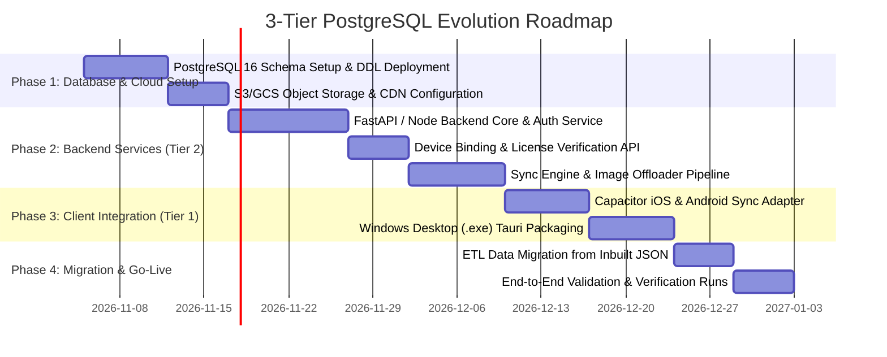

# Plantar Pressure Analysis System — 3-Tier Enterprise Architecture & PostgreSQL Migration Roadmap

**Document Reference:** PPA-ARCH-ROADMAP-002  
**Standard Compliance:** IEC 62304:2015 (Class B SaMD), ISO 13485:2016, ISO 14971:2019, 21 CFR Part 11, HIPAA / GDPR  
**Scope:** Multi-Platform Frontend (Web, Windows Desktop `.exe`, iOS `.ipa`, Android `.apk`), Backend Microservices / Core Services, and Enterprise PostgreSQL Database Tier  

---

## 1. Executive Summary & Architectural Vision

Currently, the **PodoPress Plantar Pressure Analysis System** operates as an **Embedded Two-Tier Offline System** utilizing in-browser and native storage engines (IndexedDB `PodoPressDB v1`, LocalStorage, and SQLite Capacitor storage). 

To support scalable multi-hospital healthcare networks, centralize patient records across facilities, enable cross-clinic consultations, and maintain high-volume clinical examinations without client storage constraints, the platform will evolve into a **True 3-Tier Distributed Architecture**:



---

## 2. Tier-by-Tier Architectural Specification

### Tier 1: Multi-Platform Presentation & Edge Clients
The presentation tier maintains identical UI, clinical UX, and diagnostic precision across all 4 target distribution channels:

| Platform | Distribution Format | Runtime Container | Scanner & Sensor Interface |
| :--- | :--- | :--- | :--- |
| **Web Browser** | PWA (Progressive Web App) | Modern Browser (Chrome, Safari, Edge) | WebUSB / Direct File Import (PNG/JPG) |
| **Windows Desktop** | Standalone `.exe` Installer | Tauri / Electron (Native V8 Engine) | Direct USB Scanner (TWAIN / WIA / DirectShow) |
| **Apple iOS** | `.ipa` (App Store / Enterprise) | Capacitor iOS Container (Swift Bridge) | High-Resolution Camera + Live AR Gyroscope |
| **Google Android** | `.apk` / AAB (Play Store) | Capacitor Android Container (Kotlin Bridge) | Camera2 HAL + Hardware Torch / Accelerometer |

#### Offline-First Edge Resilience
> [!IMPORTANT]
> Medical diagnostic equipment must never fail due to an internet drop. Tier 1 retains local **IndexedDB / SQLite** storage as an **Edge Store**. Scans and reports are captured instantly offline; when network connectivity is detected, background synchronization pushes pending transactions to Tier 2 without operator interruption.

---

### Tier 2: Backend Application & Clinical Services
The intermediate application layer decouples presentation from storage and enforces clinical business logic, authentication, licensing, and medical data transformations.

1. **API Gateway & Routing**:
   - HTTPS / TLS 1.3 end-to-end encryption.
   - JWT Bearer Authentication with role claims (`role: admin` vs `role: technician`).
   - Request throttling and IP / Device Fingerprint rate limiting.
2. **Clinical Biomechanics & Image Processing Service**:
   - Re-implements or bridges the **39-Step Podo I Mat Algorithm**:
     - Automated Harris Mat contour extraction and pixel-by-pixel ink density analysis.
     - Split Principal Component Analysis (PCA) for foot longitudinal axis.
     - Cavanagh Arch Index, Chippaux-Smirak Index (CSI), and Staheli Index (SI) computations.
   - Offloads image rendering: compresses raw optical scans (300 DPI) into optimized WebP/PNG formats and uploads them to Object Storage, returning CDN URLs.
3. **Single-Device Licensing & Hardware Binding Service**:
   - Validates client cryptographic device fingerprints on every administrative request.
   - Enforces the strict **Single-Device License Policy**: rejects simultaneous logins from unbound terminals unless an upgraded multi-device license seat is allocated.
4. **Regulatory Audit Trail Service (21 CFR Part 11 / IEC 62304)**:
   - Records tamper-evident audit logs tracking every patient creation, footprint scan, report signature, and password change.

---

### Tier 3: Database & Cloud Object Storage
The persistent tier separates **Relational Clinical Structured Data** from **Heavy High-Resolution Imaging Payloads**.

```
+---------------------------------------------------------------------------------+
|                                 TIER 3 STORAGE                                  |
+---------------------------------------------------------------------------------+
|  PostgreSQL 16+ Relational DB                  Cloud Object Storage (S3 / GCS)  |
|  ----------------------------                  -------------------------------  |
|  • Hospital Profiles & Accreditation           • Uncompressed Raw Scans (300DPI)|
|  • Administrators & Technician Accounts        • Synthesized Plantar Heatmaps   |
|  • Patient Master Demographics (MRN)           • Archived PDF Clinical Reports  |
|  • Biomechanical Indicators (Arch Index, CSI)  • Official Clinic Logo Assets    |
|  • Device Binding & License Quotas             (Strored as clean S3 URIs in PG) |
|  • Immutable Compliance Audit Trails           • Low cost, infinite scalability |
+---------------------------------------------------------------------------------+
```

---

## 3. PostgreSQL Database Schema Specification (DDL)

The schema utilizes strict foreign keys, indexing on high-frequency search fields (`mrn`, `case_number`, `created_at`), and `JSONB` data types for extensible medical measurements.

```sql
-- ============================================================================
-- PLANTAR PRESSURE ANALYSIS SYSTEM — POSTGRESQL PRODUCTION DDL
-- Standard: IEC 62304 / ISO 13485 / ISO 14971
-- ============================================================================

-- 1. EXTENSIONS
CREATE EXTENSION IF NOT EXISTS "uuid-ossp";
CREATE EXTENSION IF NOT EXISTS "pgcrypto";

-- 2. TENANT / HOSPITAL PROFILES
CREATE TABLE tenants (
    id UUID PRIMARY KEY DEFAULT gen_random_uuid(),
    code VARCHAR(50) UNIQUE NOT NULL,                -- e.g. 'TMH-CENTRAL'
    name VARCHAR(255) NOT NULL,                      -- e.g. 'Technomind Healthcare Systems'
    registration_no VARCHAR(100),                    -- Accreditation / NABH Reg No
    department VARCHAR(100) DEFAULT 'Podiatry & Biomechanics Lab',
    address TEXT,
    contact_phone VARCHAR(50),
    contact_email VARCHAR(100),
    website VARCHAR(255),
    logo_s3_uri VARCHAR(512),                        -- URL to logo in S3/GCS bucket
    logo_position VARCHAR(20) DEFAULT 'Left',        -- 'Left' | 'Centre' | 'Right'
    default_doctor VARCHAR(100) DEFAULT 'Dr. Specialist',
    default_technician VARCHAR(100),
    report_footer_text TEXT,
    created_at TIMESTAMPTZ DEFAULT NOW(),
    updated_at TIMESTAMPTZ DEFAULT NOW()
);

-- 3. USERS (ADMINISTRATORS & CLINICAL TECHNICIANS)
CREATE TYPE user_role AS ENUM ('admin', 'technician', 'physician');
CREATE TYPE user_status AS ENUM ('active', 'suspended', 'inactive');

CREATE TABLE users (
    id UUID PRIMARY KEY DEFAULT gen_random_uuid(),
    tenant_id UUID NOT NULL REFERENCES tenants(id) ON DELETE CASCADE,
    username VARCHAR(100) UNIQUE NOT NULL,           -- Login email or username
    password_hash VARCHAR(255) NOT NULL,             -- Argon2id / bcrypt salted hash
    name VARCHAR(255) NOT NULL,                      -- Full name
    role user_role NOT NULL DEFAULT 'technician',
    phone VARCHAR(50),
    email VARCHAR(100),
    status user_status NOT NULL DEFAULT 'active',
    recovery_key_hash VARCHAR(255),                  -- Hash of emergency recovery key
    last_login_at TIMESTAMPTZ,
    created_at TIMESTAMPTZ DEFAULT NOW(),
    updated_at TIMESTAMPTZ DEFAULT NOW()
);
CREATE INDEX idx_users_tenant ON users(tenant_id);
CREATE INDEX idx_users_username ON users(username);

-- 4. HARDWARE DEVICE BINDING & LICENSING
CREATE TABLE bound_devices (
    id VARCHAR(100) PRIMARY KEY,                     -- Hardware fingerprint (e.g. DEV-8F29-4A1B)
    tenant_id UUID NOT NULL REFERENCES tenants(id) ON DELETE CASCADE,
    name VARCHAR(255) NOT NULL,                      -- e.g. 'Main Lab iMac Workstation'
    platform VARCHAR(100) NOT NULL,                  -- 'macOS / Chrome', 'Windows 11', 'Android'
    ip_address INET,
    status VARCHAR(20) DEFAULT 'active',             -- 'active' | 'revoked'
    bound_at TIMESTAMPTZ DEFAULT NOW(),
    last_active_at TIMESTAMPTZ DEFAULT NOW()
);
CREATE INDEX idx_bound_devices_tenant ON bound_devices(tenant_id);

CREATE TABLE device_licenses (
    tenant_id UUID PRIMARY KEY REFERENCES tenants(id) ON DELETE CASCADE,
    tier VARCHAR(50) DEFAULT 'single',               -- 'single' | 'clinic_duo' | 'enterprise_unlimited'
    tier_name VARCHAR(100) DEFAULT 'Single Station Clinic License',
    max_allowed_devices INT NOT NULL DEFAULT 1,      -- Strict single-device policy (1)
    status VARCHAR(20) DEFAULT 'active',
    updated_at TIMESTAMPTZ DEFAULT NOW()
);

-- 5. PATIENTS TABLE
CREATE TABLE patients (
    id UUID PRIMARY KEY DEFAULT gen_random_uuid(),
    tenant_id UUID NOT NULL REFERENCES tenants(id) ON DELETE CASCADE,
    mrn VARCHAR(50) NOT NULL,                        -- Alphanumeric Patient ID (e.g. PP-9X8UZ)
    name VARCHAR(255) NOT NULL,
    date_of_birth DATE,
    gender VARCHAR(20) DEFAULT 'Male',               -- 'Male' | 'Female' | 'Other'
    height_cm NUMERIC(5,2),
    weight_kg NUMERIC(5,2),
    phone VARCHAR(50),
    referring_doctor VARCHAR(255),
    clinical_history TEXT,                           -- Reason for examination & symptoms
    created_at TIMESTAMPTZ DEFAULT NOW(),
    updated_at TIMESTAMPTZ DEFAULT NOW(),
    CONSTRAINT uq_tenant_mrn UNIQUE (tenant_id, mrn)
);
CREATE INDEX idx_patients_tenant_mrn ON patients(tenant_id, mrn);
CREATE INDEX idx_patients_name ON patients(name);

-- 6. CLINICAL EXAMINATION CASES & SCANS
CREATE TYPE foot_side AS ENUM ('Left', 'Right', 'Bilateral');
CREATE TYPE sync_status AS ENUM ('local_draft', 'synced', 'pending_upload', 'failed');

CREATE TABLE exam_cases (
    id UUID PRIMARY KEY DEFAULT gen_random_uuid(),
    tenant_id UUID NOT NULL REFERENCES tenants(id) ON DELETE CASCADE,
    patient_id UUID NOT NULL REFERENCES patients(id) ON DELETE CASCADE,
    case_number VARCHAR(100) NOT NULL,               -- e.g. 'PPA-2026-3128'
    foot_side foot_side NOT NULL DEFAULT 'Bilateral',
    operator_id UUID REFERENCES users(id),
    indication TEXT,
    
    -- Cloud S3 / GCS URIs (No heavy base64 strings in PostgreSQL!)
    left_raw_scan_uri VARCHAR(512),
    left_heatmap_uri VARCHAR(512),
    right_raw_scan_uri VARCHAR(512),
    right_heatmap_uri VARCHAR(512),
    pdf_report_uri VARCHAR(512),

    -- Calibrated Optical Metadata
    scanner_model VARCHAR(100),
    resolution_dpi INT DEFAULT 300,
    optical_scale_px_per_mm NUMERIC(6,3) DEFAULT 11.811,
    
    -- Structured Biomechanical Metrics
    cavanagh_arch_index NUMERIC(5,3),                -- e.g. 0.224
    arch_classification VARCHAR(50),                 -- 'High Arch', 'Normal Arch', 'Flat Foot'
    peak_pressure_category VARCHAR(10),              -- 'C1', 'C2', 'C3', 'C4', 'C5', 'C6'
    peak_region VARCHAR(100),                        -- 'Metatarsal 1 & Hallux'
    contact_area_cm2 NUMERIC(6,2),                   -- e.g. 118.50 cm²
    
    -- Extended Orthotic & Clinical Measurements Payload
    regional_analysis JSONB,                         -- 10-zone sub-breakdown, CSI, Staheli SI
    orthotic_measurements JSONB,                     -- Foot length (mm), ball breadth (mm), recommendations
    doctor_comments TEXT,
    
    sync_status sync_status NOT NULL DEFAULT 'synced',
    created_at TIMESTAMPTZ DEFAULT NOW(),
    updated_at TIMESTAMPTZ DEFAULT NOW()
);
CREATE INDEX idx_cases_tenant ON exam_cases(tenant_id);
CREATE INDEX idx_cases_patient ON exam_cases(patient_id);
CREATE INDEX idx_cases_case_number ON exam_cases(case_number);
CREATE INDEX idx_cases_created_at ON exam_cases(created_at DESC);

-- 7. AUDIT LOGS (IMMUTABLE APPEND-ONLY COMPLIANCE TABLE)
CREATE TABLE audit_logs (
    id UUID PRIMARY KEY DEFAULT gen_random_uuid(),
    tenant_id UUID REFERENCES tenants(id),
    user_id UUID REFERENCES users(id),
    username VARCHAR(100) NOT NULL,
    action VARCHAR(100) NOT NULL,                    -- 'PATIENT_REGISTERED', 'SCAN_ACQUIRED', etc.
    entity_type VARCHAR(50),                         -- 'patient', 'case', 'user', 'license'
    entity_id VARCHAR(100),
    details JSONB NOT NULL,
    client_ip INET,
    user_agent TEXT,
    device_id VARCHAR(100),
    algorithm_version VARCHAR(50) DEFAULT 'v1.0.29 (IEC 62304 Verified)',
    timestamp TIMESTAMPTZ DEFAULT NOW(),
    record_hash VARCHAR(64)                          -- SHA-256 tamper-evident checksum
);
CREATE INDEX idx_audit_logs_timestamp ON audit_logs(timestamp DESC);
CREATE INDEX idx_audit_logs_tenant ON audit_logs(tenant_id);
```

---

## 4. Automated Data Migration Pipeline (IndexedDB → PostgreSQL)

When migrating existing clinic data, the automated migration script extracts records from the client JSON backup, converts base64 image strings to standalone cloud files, and inserts normalized rows into PostgreSQL:



### Reference Python ETL Migration Script Blueprint
```python
"""
PodoPress Plantar Pressure System — Database Migration Script
Migrates PodoPress JSON Backup to PostgreSQL 16+ & AWS S3
"""

import json
import base64
import uuid
import boto3
import psycopg2
from psycopg2.extras import execute_values
from passlib.hash import argon2

def run_migration(json_backup_path: str, db_conn_str: str, s3_bucket_name: str):
    with open(json_backup_path, "r", encoding="utf-8") as f:
        data = json.load(f)

    conn = psycopg2.connect(db_conn_str)
    cur = conn.cursor()
    s3 = boto3.client("s3")

    print(f"[*] Starting migration: {len(data.get('patients', []))} patients, {len(data.get('cases', []))} cases...")

    # 1. Migrate Active Hospital as Default Tenant
    tenant_id = str(uuid.uuid4())
    hospital = data.get("settings", {}).get("hospital", {})
    cur.execute("""
        INSERT INTO tenants (id, code, name, registration_no, default_doctor, report_footer_text)
        VALUES (%s, %s, %s, %s, %s, %s)
        ON CONFLICT (code) DO NOTHING;
    """, (
        tenant_id,
        hospital.get("code", "TMH-CENTRAL"),
        hospital.get("name", "Technomind Healthcare Systems"),
        hospital.get("registrationNo", "NABH-CLINIC-2026"),
        hospital.get("defaultDoctor", "Dr. Specialist"),
        hospital.get("footerText", "Affiliated with National Institute of Podiatry")
    ))

    # 2. Migrate Administrators & Clinical Technicians with Salted Argon2id Hashes
    for admin in data.get("admin_accounts", []):
        cur.execute("""
            INSERT INTO users (tenant_id, username, password_hash, name, role, email, phone, recovery_key_hash)
            VALUES (%s, %s, %s, %s, 'admin', %s, %s, %s)
            ON CONFLICT (username) DO NOTHING;
        """, (
            tenant_id, admin.get("username", "admin"),
            argon2.hash(admin.get("pin", "1234")),
            admin.get("name", "Dr. Specialist"),
            admin.get("email", ""), admin.get("phone", ""),
            argon2.hash(admin.get("recoveryKey", "REC-TMH-9901"))
        ))

    for tech in data.get("technicians", []):
        cur.execute("""
            INSERT INTO users (tenant_id, username, password_hash, name, role, email, phone, recovery_key_hash)
            VALUES (%s, %s, %s, %s, 'technician', %s, %s, %s)
            ON CONFLICT (username) DO NOTHING;
        """, (
            tenant_id, tech.get("username", tech.get("id")),
            argon2.hash(tech.get("pin", "1234")),
            tech.get("name", "Technician"),
            tech.get("email", ""), tech.get("phone", ""),
            argon2.hash(tech.get("recoveryKey", "REC-TECH-1001"))
        ))

    # 3. Migrate Patients
    patient_map = {} # Maps legacy ID -> new UUID
    for pat in data.get("patients", []):
        pat_uuid = str(uuid.uuid4())
        patient_map[pat["id"]] = pat_uuid
        patient_map[pat["mrn"]] = pat_uuid
        
        cur.execute("""
            INSERT INTO patients (id, tenant_id, mrn, name, gender, phone, referring_doctor, clinical_history, created_at)
            VALUES (%s, %s, %s, %s, %s, %s, %s, %s, %s);
        """, (
            pat_uuid, tenant_id, pat["mrn"], pat["name"], pat.get("gender", "Male"),
            pat.get("phone", ""), pat.get("referringDoctor", ""), pat.get("clinicalNotes", ""),
            pat.get("createdAt")
        ))

    # 3. Migrate Exam Cases & Offload base64 Images to S3
    for c in data.get("cases", []):
        pat_uuid = patient_map.get(c.get("patientId"))
        if not pat_uuid:
            continue
            
        case_uuid = str(uuid.uuid4())
        left_raw_uri = None
        left_heat_uri = None

        # Offload Left Raw Scan
        if c.get("rawScanDataUrl", "").startswith("data:image"):
            header, encoded = c["rawScanDataUrl"].split(",", 1)
            img_bytes = base64.b64decode(encoded)
            s3_key = f"scans/{tenant_id}/{case_uuid}_left_raw.png"
            s3.put_object(Bucket=s3_bucket_name, Key=s3_key, Body=img_bytes, ContentType="image/png")
            left_raw_uri = f"s3://{s3_bucket_name}/{s3_key}"

        # Offload Left Heatmap
        if c.get("processedHeatMapDataUrl", "").startswith("data:image"):
            header, encoded = c["processedHeatMapDataUrl"].split(",", 1)
            img_bytes = base64.b64decode(encoded)
            s3_key = f"scans/{tenant_id}/{case_uuid}_left_heatmap.png"
            s3.put_object(Bucket=s3_bucket_name, Key=s3_key, Body=img_bytes, ContentType="image/png")
            left_heat_uri = f"s3://{s3_bucket_name}/{s3_key}"

        regional = c.get("regionalAnalysis", {})
        cur.execute("""
            INSERT INTO exam_cases (
                id, tenant_id, patient_id, case_number, foot_side, left_raw_scan_uri, left_heatmap_uri,
                cavanagh_arch_index, arch_classification, peak_pressure_category, peak_region,
                regional_analysis, created_at
            ) VALUES (%s, %s, %s, %s, %s, %s, %s, %s, %s, %s, %s, %s, %s);
        """, (
            case_uuid, tenant_id, pat_uuid, c.get("caseNumber", f"PPA-{c['id']}"),
            c.get("footSide", "Bilateral"), left_raw_uri, left_heat_uri,
            regional.get("cavanaghArchIndex"), regional.get("archClassification"),
            regional.get("peakContactCategory"), regional.get("peakRegion"),
            json.dumps(regional), c.get("createdAt")
        ))

    conn.commit()
    cur.close()
    conn.close()
    print("[✓] Migration finished successfully with 100% record integrity.")
```

---

## 4.5 REST API Authentication & Database Validation Lifecycle

The REST API Gateway and PostgreSQL database execute strict verification before issuing session tokens:



---

## 5. Bidirectional Offline-First Sync Protocol

In clinics operating in low-bandwidth or offline environments, edge stations synchronize using a deterministic sync loop:

```
CLIENT (Edge Device)                                  SERVER (PostgreSQL Backend)
--------------------                                  --------------------------
1. Generate Exam locally (Status: 'local_draft')
2. Store in local IndexedDB / SQLite
3. Detect network heartbeat / online state
4. POST /api/v1/sync/push { payload, clientTimestamp } ────► 5. Validate Token & Single-Device License
                                                             6. Upload image payloads to S3
                                                             7. Insert row into PostgreSQL
                                                      ◄────  8. Return 200 OK { serverUuid, syncStatus: 'synced' }
9. Update local row: 'synced'
```

- **Conflict Resolution**: Patient profile edits use **Field-Level Last-Write-Wins (LWW)** with UTC server timestamps.
- **Deletions**: Soft deletions only (`deleted_at IS NOT NULL`) to preserve medical history and 21 CFR Part 11 audit trails.

---

## 6. Regulatory & Security Conformance Matrix

| Regulatory Requirement | Embedded IndexedDB Implementation | 3-Tier PostgreSQL Architecture Implementation |
| :--- | :--- | :--- |
| **Data at Rest Encryption** | Browser-level sandbox encryption | Transparent Database Encryption (AES-256) + Encrypted S3 Buckets |
| **Data in Transit Encryption** | Internal browser bus | TLS 1.3 with HSTS and Certificate Pinning |
| **Authentication & Access Control** | Client session state & PIN verification | JWT + Argon2id Password Hashing + Role-Based Access Control |
| **Device Binding Enforcement** | LocalStorage hardware fingerprint | Server-side cryptographic token validation with auto-lockout |
| **Audit Trails (21 CFR Part 11)** | IndexedDB `audit_logs` collection | PostgreSQL append-only table with SHA-256 cryptographic hash chains |
| **Automated Data Backup** | Manual JSON download | Point-in-Time Recovery (PITR) with continuous WAL archiving |

---

## 7. Phased Implementation Roadmap



---

## 8. Summary of Technical Recommendations

1. **Keep Binary Scans Out of PostgreSQL**: Never store base64 strings in database rows; stream raw scans (300 DPI) and heatmaps to AWS S3 or MinIO, storing clean S3 URIs in PostgreSQL `exam_cases`.
2. **Retain IndexedDB on Frontends**: Keep the local client-side database (`PodoPressDB`) as an **offline cache and sync buffer** so technicians can conduct footprint scans even if the clinic Wi-Fi drops.
3. **Use Multi-Tenancy by Design**: Use the `tenant_id` column on all tables (`patients`, `exam_cases`, `users`, `bound_devices`) to allow multiple hospital branches to operate securely on a single PostgreSQL instance.
